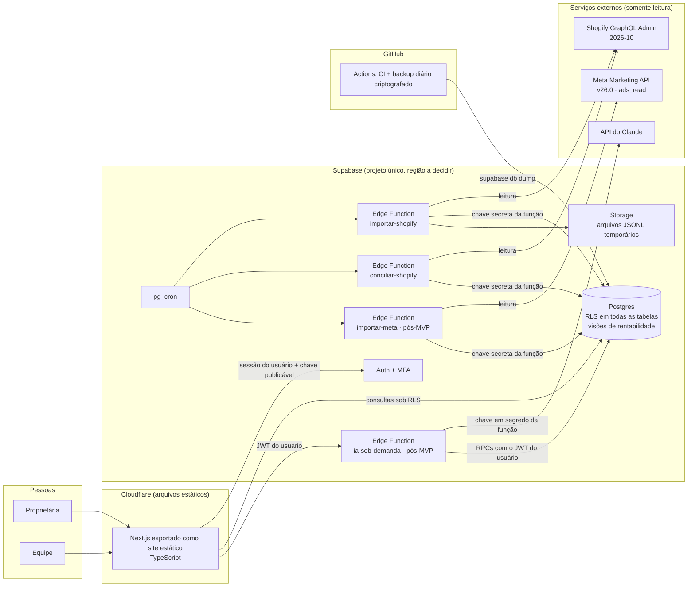

# Rocco OS · arquitetura técnica consolidada (revisão 2)

**Status:** aprovada conceitualmente. **Implementação não autorizada.** Nada foi construído e nenhuma chamada foi feita aos dados da loja ou da conta de anúncios.
**Revisão:** 23/10/2026. Substitui a versão de 22/10/2026, que fica no histórico do git.

---

## 0. Como ler este documento

| Marca | Significado |
|---|---|
| **[CONFIRMADO dd/mm]** | Visto em fonte oficial na data indicada. A fonte está na linha ou na seção 15 |
| **[HIPÓTESE]** | Provável, mas sem evidência suficiente. Traz o teste que confirma ou derruba |
| **[LACUNA]** | Não se sabe. Traz o jeito de descobrir e quem decide |

**Como verifiquei, e os limites disso:**
- **Shopify:** usei a busca de documentação oficial (shopify.dev, pelo conector Shopify) e a inspeção do esquema GraphQL Admin pelo mesmo conector. Essa inspeção usa uma versão de esquema fixada pelo conector, que ele não informa. Os campos foram conferidos ali e, quando citados como 2026-10, nas páginas da doc 2026-10.
- **Meta, Supabase, Netlify, Cloudflare, GitHub e Anthropic:** usei a busca na web restrita aos domínios oficiais. A política de rede deste ambiente bloqueia o acesso direto a shopify.dev e developers.facebook.com, então não abri as páginas inteiras. O que veio só por trecho de busca está marcado assim.
- **Dados da loja e da conta de anúncios:** nenhuma consulta foi feita. Tudo o que depende deles virou lacuna da Fase 0 (auditoria técnica).

---

## 1. Resumo executivo

**O que muda nesta revisão:**

1. **Três indicadores com nomes e regras próprias:** margem de contribuição, resultado após publicidade e lucro líquido gerencial. Cada componente tem origem rastreada e um status: confirmado, parametrizado ou pendente. Com algum componente pendente, o sistema mostra as partes e **não mostra o número como lucro**.
2. **O custo histórico não sai da Shopify pela API comum.** O pedido não tem campo de custo, e o `InventoryItem.unitCost` é o custo **de hoje**. O histórico vem de três fontes possíveis, sem nunca reaproveitar o custo atual no passado:
   - planilha ou notas aprovadas por você;
   - fotografia diária do custo, tirada pelo sistema a partir do primeiro dia;
   - o relatório da própria Shopify (ShopifyQL), que exige uma permissão de dados de cliente nível 2 (decisão D5).
3. **Publicidade por produto só com metodologia aprovada.** O padrão é "anúncio ligado ao produto por você". O gasto sem ligação fica numa linha **"não alocado"**, sem rateio automático.
4. **Infraestrutura sem custo e sem servidor web.** A interface é estática na Cloudflare (requisições a arquivos estáticos são gratuitas e ilimitadas). Toda a lógica de servidor fica nas Edge Functions do Supabase. Isso troca a Netlify Free, que pausa todos os projetos ao esgotar créditos. O Supabase continua no Free, com backup diário criptografado pelo GitHub Actions (guia oficial) e gatilhos objetivos para ir ao Pro.
5. **O MVP ficou menor:** auditoria técnica, importação da Shopify, validação dos dados e margem de contribuição. Meta Ads (só leitura), IA sob demanda e o resto vêm depois.
6. **A IA fica fora do MVP.** Quando entrar, cada chamada reserva orçamento no banco antes de ir à API. Há uma segunda trava no limite mensal do workspace no Console da Anthropic.

**Custo mensal previsto no MVP:** US$ 0 de infraestrutura, com as premissas da seção 9. A IA só entra depois do MVP, com teto proposto de US$ 5/mês.

**Dinheiro no bolso:** o MVP responde "quanto cada produto deixa depois do custo, das taxas e do frete". Esse é o número que decide preço, compra e corte de produto. Meta e IA aproximam do caixa só depois que esse número estiver certo. Antes disso, só aumentam o trabalho.

---

## 2. Arquitetura revisada

### 2.1 Diagrama



### 2.2 Componentes e escolhas

| Componente | Escolha | Por quê |
|---|---|---|
| Interface | Next.js + TypeScript com **exportação estática**, servida como arquivos estáticos na Cloudflare | Sem servidor web, a interface não tem limite de execução nem custo. A segurança dos dados fica na RLS do banco, não na interface |
| Backend | **Só Supabase**: Postgres, Auth, Edge Functions, pg_cron, Storage | Um lugar para segredos, logs e permissões |
| Importação | Edge Functions acionadas pelo pg_cron | Vercel Hobby (cron só diário) e Netlify (pausa por crédito) ficam fora |
| Webhooks | **Fora do MVP** | Importação incremental + conciliação cobre um painel; menos superfície exposta |
| Filas, microserviços | **Não usar** | A tabela `janelas_importacao` com status já é a fila |
| IA | Pós-MVP; uma Edge Function que faz **uma chamada por pedido**, sem ferramentas nem loop autônomo | Atende "sem agentes autônomos complexos" |

**Troca em relação à versão anterior:** com exportação estática não há Server Components nem cookies httpOnly. A sessão do Supabase fica no navegador. Mitigações:
- CSP estrita, sem scripts de terceiros e sem HTML injetado;
- MFA para quem vê finanças;
- toda regra de acesso no banco (seção 6).

Se você preferir sessão em cookie no servidor, a alternativa é a Vercel Pro (US$ 20/mês), na decisão D1.

### 2.3 Princípios (inalterados)
1. O banco é a fonte de verdade. Os números saem de visões SQL testadas, e a IA só explica.
2. Só leitura nas integrações externas. No MVP não existe nenhum escopo de escrita nem código de escrita externa.
3. Permissão aplicada no banco e nas funções, não na interface.
4. Toda linha tem origem rastreada. Toda alteração é auditada.
5. Texto vindo de Shopify, Meta ou criativos é dado, nunca instrução.

---

## 3. Rentabilidade por produto

### 3.1 Três indicadores, três perguntas

| Indicador | Pergunta que responde | Nível em que existe | Fórmula |
|---|---|---|---|
| **Margem de contribuição (MC)** | Quanto cada venda deixa antes de anúncio e custos fixos? | Item, pedido, produto, dia, mês | Receita líquida de produtos + frete líquido cobrado − CMV − taxas de pagamento − custo de frete − embalagem − impostos sobre a venda |
| **Resultado após publicidade (RAP)** | Depois de pagar os anúncios, sobrou quanto? | **Loja** (dia, mês). Produto só para anúncios ligados a ele (3.4) | MC − gasto de anúncios |
| **Lucro líquido gerencial (LL)** | O negócio deu lucro no mês? | **Só loja e mês**; nunca por produto | RAP − despesas fixas e outras despesas do mês (plano Shopify, apps, ferramentas, pessoas, contador, IA…) |

O LL é **gerencial**: não substitui a contabilidade e não trata imposto sobre o lucro, que depende do regime (lacuna R3).

### 3.2 Componentes, origem e status

Cada componente, em cada pedido, tem um status:

- **confirmado:** veio de um registro da fonte (Shopify, Meta, nota ou planilha aprovada);
- **parametrizado:** calculado por uma tarifa ou alíquota **que você aprovou**, com vigência (ex.: taxa do gateway contratado);
- **pendente:** não há dado.

| Componente | Origem | Campo ou fonte | Situação da verificação |
|---|---|---|---|
| Valor bruto do item | Shopify | `LineItem.originalUnitPriceSet` × `quantity` | **[CONFIRMADO 23/10]** no esquema |
| Quantidade vigente | Shopify | `LineItem.currentQuantity` ("excluindo unidades reembolsadas e removidas") | **[CONFIRMADO 23/10]** doc 2026-10 |
| Receita líquida do item | Shopify | `LineItem.priceAfterAllDiscountsBeforeTaxesSet` ("depois de todos os descontos, excluindo quantidades reembolsadas e removidas, sem impostos") | **[CONFIRMADO 23/10]** na doc 2026-10. **[HIPÓTESE]** que exista na versão fixada; o esquema do conector não lista o campo. Teste na Fase 0 |
| Descontos do item | Shopify | `LineItem.discountAllocations[].allocatedAmountSet` (inclui descontos de quantidades reembolsadas/removidas) | **[CONFIRMADO 23/10]** |
| Desconto de frete | Shopify | `ShippingLine.discountAllocations` | **[CONFIRMADO 23/10]** (o tipo `DiscountAllocation` é usado em `ShippingLine`) |
| Reembolso de itens | Shopify | `Refund.refundLineItems{quantity, subtotalSet, restockType, lineItem}` | **[CONFIRMADO 23/10]** no esquema |
| Reembolso de frete e ajustes | Shopify | `Refund.refundShippingLines`, `Refund.orderAdjustments`, `Order.totalRefundedShippingSet` | **[CONFIRMADO 23/10]** no esquema |
| Frete cobrado | Shopify | `Order.currentShippingPriceSet` | **[CONFIRMADO 23/10]** no esquema |
| Impostos destacados no pedido | Shopify | `Order.taxesIncluded`, `currentTotalTaxSet`, `LineItem.taxLines` | **[CONFIRMADO 23/10]** no esquema |
| Pedido de teste / cancelado / editado | Shopify | `Order.test`, `cancelledAt`, `edited` | **[CONFIRMADO 23/10]** no esquema |
| **Custo do produto (CMV)** | Ver 3.3 | Pedido e item **não têm campo de custo** | **[CONFIRMADO 23/10]**: `LineItem` não tem campo de custo |
| Taxa do pagamento | Shopify Payments: `OrderTransaction.fees` | Outro gateway: parâmetro por gateway | **[CONFIRMADO 23/10]**: `fees` "só existe para transações do Shopify Payments". O gateway em uso é a lacuna R2 |
| Custo real do frete | Transportadora, Shopify Shipping ou planilha | — | **[LACUNA R9]**: fonte desconhecida. Fica pendente até você escolher |
| Embalagem | Parâmetro por pedido | — | Parametrizado, se você aprovar um valor |
| Impostos sobre a venda | Parâmetro (alíquota do regime) | — | **[LACUNA R3]**: regime e alíquota |
| Gasto de anúncios | Meta Marketing API (`spend`) | — | Pós-MVP. **[HIPÓTESE]** o valor da API pode não incluir impostos cobrados na fatura; conciliar com as faturas (Fase 4) |
| Despesas fixas | Lançamento manual mensal | — | Só para o LL |

**Regra do status do indicador:**
- **Completo:** todos os componentes confirmados ou parametrizados com aprovação vigente. Mostra o valor e lista quais partes são parametrizadas.
- **Incompleto:** algum componente pendente. Mostra os componentes disponíveis, os pendentes e a cobertura (ex.: "custo conhecido para 72% da receita"). **Não mostra soma rotulada como margem ou lucro.**
- Não existe "estimativa" dentro de um indicador completo. Valores médios inventados (ex.: "frete médio de R$ 20") não entram.

### 3.3 Custo histórico do produto

A loja só expõe o custo atual (`InventoryItem.unitCost`, **[CONFIRMADO 23/10]**; leitura com `read_inventory` ou `read_products`, e o usuário precisa da permissão "View product costs" quando permissões granulares estão ativas). A ajuda da Shopify diz que o "custo por item" é estático e que os relatórios de lucro usam o custo registrado no momento da venda (ajuda da Shopify via busca, 23/10; **[HIPÓTESE]** que valha hoje sem mudança).

**Fontes de custo, em ordem de prioridade, sem preencher lacunas com o custo atual:**

1. **Manual com evidência:** custo por variante com vigência, vindo de notas ou planilha, aprovado por você. Fonte `manual`.
2. **Fotografia diária da Shopify:** o sistema lê o `unitCost` todo dia e grava uma vigência nova quando ele muda. Só vale **a partir do primeiro dia de captura**. Fonte `shopify_foto`.
3. **ShopifyQL (`FROM sales SHOW cost_of_goods_sold`):** o esquema `sales` tem `cost_of_goods_sold`, `gross_profit`, `net_sales_with_cost_recorded` e `net_sales_without_cost_recorded` (**[CONFIRMADO 23/10]**). Para usar, o app precisa do escopo `read_reports`, **acesso nível 2 a dados protegidos de clientes** e API 2025-10 ou mais nova (**[CONFIRMADO 23/10]**). Essa fonte daria o histórico gravado pela Shopify, mas abre acesso a nome, e-mail, telefone e endereço que o sistema não precisa. **Decisão D5.** **[HIPÓTESE]** que o `cost_of_goods_sold` reflita o custo registrado na venda. Teste: comparar com o relatório de lucro do admin num mês fechado.

Antes de existir uma dessas fontes para o período, o CMV daquele item fica **pendente**.

**Devoluções e CMV** (metodologia proposta, decisão D7):
- Unidade reembolsada com reposição no estoque (`restockType` = `RETURN` ou `CANCEL`): o CMV é revertido.
- Unidade reembolsada sem reposição (`NO_RESTOCK`): o CMV continua, porque é perda.
- `LEGACY_RESTOCK`: revisar caso a caso na Fase 2. **[HIPÓTESE]** sobre o significado exato de cada valor; conferir na doc do enum na Fase 0.

### 3.4 Gasto de anúncios por produto

Não há atribuição automática de gasto a produto. Metodologias:

| Método | Como funciona | Situação |
|---|---|---|
| **A. Ligação direta (padrão)** | Você liga um anúncio (ou campanha) a um produto, com vigência, na tabela `ligacoes_anuncio_produto`. O RAP do produto usa só o gasto desses anúncios | Proposto |
| **B. Rateio** | O gasto não ligado é distribuído por um critério (ex.: participação na receita) | **Desligado.** Só com sua aprovação, e aparece sempre como "rateado", nunca misturado com A |

Na visão por produto, o gasto sem ligação aparece numa linha própria: **"publicidade não alocada"**. O RAP da loja sempre usa o gasto total.

### 3.5 Rateios dentro da margem (custos do pedido)

Taxa de pagamento, frete e embalagem são do **pedido**, não do item. Para a MC por produto, a proposta (decisão D7) é ratear pela receita líquida de cada item no pedido. Esse rateio é documentado, testado e aparece rotulado como "rateado por receita" na tela. A MC por pedido e por loja não depende de rateio.

### 3.6 Datas e fusos
- O pedido entra no dia de `processedAt`, no fuso da loja (`shop.ianaTimezone`, **[HIPÓTESE]**; confirmar o campo na Fase 0). O reembolso entra no dia de `Refund.processedAt`. Assim, um mês fechado não muda quando chega um reembolso: o reembolso aparece no mês em que aconteceu (decisão D7).
- O gasto da Meta entra no dia do fuso da conta de anúncios (**[LACUNA L7]**). Se os fusos forem diferentes, o RAP diário fica marcado como "fusos diferentes" até a conversão ser definida.

---

## 4. Shopify

### 4.1 Fatos confirmados

| Tema | Fato | Fonte / data |
|---|---|---|
| Criação do app | Não dá mais para criar apps personalizados no admin. Apps novos saem do Dev Dashboard ou da Shopify CLI | shopify.dev, "Generate access tokens for admin-created custom apps" · 22/10 |
| Autenticação | *Client credentials grant*: client ID + secret → token com `expires_in` sempre 86399 s (24 h). O token não pede escopos: lê os escopos da versão do app liberada no Dev Dashboard | shopify.dev, "Authenticate an app for stores in your organization" · 23/10 |
| Pré-requisito | Só funciona quando **o app e a loja estão na mesma organização** do Dev Dashboard. Ser dona da loja não coloca a loja na organização. O erro, se não estiverem, é `shop_not_permitted` | mesma página · 23/10 |
| Tokens expiráveis | A obrigação de 01/01/2027 vale para apps públicos; apps criados pelo lojista não são afetados | changelog Shopify 20/05/2026 · 22/10 |
| Versão | 2026-10 é a última estável, acessível até 16/10/2027. Uma versão por trimestre | shopify.dev, versionamento · 22/10 |
| Pedidos antigos | `read_orders` dá 60 dias. Com `read_all_orders`, todos. App de organização de lojista não precisa de aprovação da Shopify para `read_all_orders` | shopify.dev, access scopes · 22/10 |
| Limite de taxa | Custo por consulta. Standard: 100 pontos/s; Advanced: 200; Plus: 1000. **Uma consulta não pode passar de 1.000 pontos**. A resposta traz `extensions.cost.throttleStatus` | shopify.dev, GraphQL rate limits · 23/10 |
| Paginação | Até 250 itens por página, cursores `after`/`before` | shopify.dev, pagination · 23/10 |
| Filtros de pedidos | `orders(query:)` aceita `updated_at`, `created_at`, `processed_at`, `test`, `status`, `financial_status`. `sortKey` aceita `UPDATED_AT` e `PROCESSED_AT` | esquema via conector · 23/10 |
| Exportação em massa | `bulkOperationRunQuery` aceita até 5 conexões e profundidade de 2 níveis. Resultado em JSONL, que expira em 7 dias. A partir da 2026-01, até **5 operações simultâneas** por loja | shopify.dev, bulk operations · 23/10 |
| Dados protegidos | Nível 1 = dados de cliente sem nome, endereço, telefone e e-mail; nível 2 = com eles. Na tabela da Shopify: app personalizado tem nível 1 e 2 "sempre disponíveis"; app criado no admin, nível 2 "varia por plano" | shopify.dev, protected customer data · 23/10 |
| Webhooks | HMAC em `X-Shopify-Hmac-SHA256`, deduplicar por `X-Shopify-Webhook-Id`, responder 2xx em até 5 s, 8 tentativas em 4 h. Existem os tópicos `orders/edited` e `orders/delete` | shopify.dev · 22–23/10 |
| Custo | `InventoryItem.unitCost` = custo atual. Nenhum campo de custo no pedido ou item | esquema + doc 2026-10 · 23/10 |

### 4.2 Hipóteses (a validar na Fase 0, só com leitura)

| ID | Hipótese | Como validar |
|---|---|---|
| H1 | A loja da Rocco aparece na mesma organização do Dev Dashboard, e o *client credentials grant* funciona | Abrir o Dev Dashboard → "Dev stores"/lojas. Se não aparecer, usar o fluxo *authorization code* (mais trabalho; decisão D3) |
| H2 | O app do Dev Dashboard instalado na loja conta como "app personalizado" na tabela de dados protegidos | Tela de acesso a dados protegidos do app ao criar |
| H3 | `priceAfterAllDiscountsBeforeTaxesSet` está disponível na 2026-10 para este app | Consulta de 1 pedido |
| H4 | Reembolso, edição e cancelamento atualizam `Order.updatedAt` | Em pedidos reais já reembolsados: conferir `updatedAt ≥ refund.processedAt`. Se falhar, a varredura semanal (4.4) cobre |
| H5 | Uma exportação em massa com `orders → lineItems` + `refunds → refundLineItems` cabe no limite de conexões e profundidade | Validar a consulta antes de rodar. Se não couber, separar reembolsos numa segunda exportação |
| H6 | O fuso da loja vem de `shop.ianaTimezone` | Esquema `Shop` |
| H7 | `customerJourneySummary.lastVisit.utmParameters` (existe no esquema) pode ser lido sem nível 2 de dados protegidos | Ver o aviso de dados protegidos no tipo; **só pós-MVP** e só se D5 permitir |

### 4.3 Escopos propostos para o MVP

`read_products`, `read_inventory`, `read_orders`, `read_all_orders`. **Nenhum `write_*`.** `read_reports` só se D5 aprovar ShopifyQL.

O critério de aceite lê os escopos efetivamente concedidos do campo `scope` da resposta do token e falha se aparecer qualquer `write_`.

### 4.4 Importação reiniciável, deduplicação, conciliação e alterações

**Dados em duas camadas:**
1. `shopify_registros` (bruto, sem dados pessoais): uma linha por **versão** de pedido ou produto, com chave `(gid, origem_atualizado_em, hash_payload)`. Não guarda campos de cliente porque eles não são pedidos nas consultas; um teste verifica o texto das consultas.
2. Tabelas normalizadas (`pedidos`, `itens_pedido`, `reembolsos`…), sempre reconstruídas a partir da **última versão** de cada gid.

**Carga inicial reiniciável:**
- O período aprovado (D4) é dividido em janelas mensais na tabela `janelas_importacao`, com status `pendente → exportando → baixado → processando → concluida | erro`.
- Cada janela roda uma exportação em massa (`created_at` dentro da janela). O JSONL é copiado para o Storage na hora, porque a URL expira em 7 dias, e é processado em blocos com `linha_checkpoint`.
- Se cair, a janela recomeça do checkpoint. Reprocessar uma janela inteira não muda nada, porque o *upsert* é idempotente.
- Até 5 janelas simultâneas é o limite da Shopify; o sistema usa 2, por folga.

**Incremental (a cada hora):**
- `orders(query: "updated_at:>='<cursor − 15 min>'", sortKey: UPDATED_AT, first: ≤250)`, paginado, respeitando o `throttleStatus`.
- O cursor só avança depois que a página foi gravada, na mesma transação.

**Deduplicação e ordem:**
- Uma versão já existente (mesmo hash) é ignorada.
- Uma versão com `updatedAt` mais antigo que a gravada não substitui a mais nova.
- `unique` em todos os gids.

**Alterações em pedidos:**

| Evento | Tratamento |
|---|---|
| Edição (`Order.edited`) | Nova versão. Itens são recalculados por `currentQuantity`. Itens removidos ficam com quantidade vigente 0, sem apagar a linha |
| Reembolso | Gravado em `reembolsos` e `reembolso_itens` com a data própria. Não altera o mês do pedido |
| Cancelamento | `cancelado_em` preenchido. Sai da receita do dia do cancelamento (D7) |
| Pedido de teste | `teste = true`, fora de todos os indicadores |
| Pedido apagado na loja | Não aparece no incremental. A conciliação detecta a diferença de contagem e marca `removido_na_origem = true` depois de confirmar por consulta direta ao gid |

**Conciliação:**
- **Diária:** para cada um dos últimos 7 dias (fuso da loja), compara contagem de pedidos não-teste e soma de `currentTotalPriceSet` entre a Shopify e o banco. Na Shopify, usa uma consulta paginada só com `id`, `processedAt`, `currentTotalPriceSet`, `test`.
- **Semanal:** a mesma conferência para os últimos 90 dias, mais a releitura completa dos pedidos com reembolso nesse período. Isso cobre o caso de H4 ser falsa.
- Divergência → a janela é reimportada e há alerta na tela "Saúde". A conciliação nunca "corrige" números à mão.
- **Aceite manual:** num mês fechado, os totais do sistema batem com o relatório da Shopify no mesmo filtro (seção 10).

**Retentativas:**
- Erro de limite de taxa ou 5xx: espera exponencial (2, 4, 8, 16, 32 s), até 5 tentativas.
- 401/403: para, desativa a integração e avisa. Não insiste.
- Erro em uma linha: registra, pula e marca a execução como `parcial`.

---

## 5. Meta Ads (pós-MVP, só leitura)

### 5.1 Princípio
O Rocco OS terá **o próprio app Meta e o próprio usuário do sistema** (*system user*), só com `ads_read`.
- **Não reutiliza** o token do conector Meta das sessões do Claude, que tem ferramentas de escrita.
- **Não reutiliza** nenhum token com `ads_management`.

### 5.2 O que está confirmado e o que não está

| Item | Situação |
|---|---|
| `ads_read` permite ler o Ads Insights de contas próprias ou concedidas; é pré-requisito do Insights | **[CONFIRMADO 22–23/10, via busca]** Permissions Reference e Ads Insights |
| `ads_management` cria e altera anúncios: **não pedir** | **[CONFIRMADO 22/10, via busca]** |
| Versão atual v26.0 (29/07/2026) | **[CONFIRMADO 22/10, via busca]** |
| Token de *system user*: expirável de 60 dias ou sem expiração. Remover o app em "Apps conectados" invalida | **[CONFIRMADO 22/10, via busca]**. Proposta: token de 60 dias com rotação |
| Limites por conta de anúncio e caso de uso; cabeçalho `X-Business-Use-Case-Usage`; erros 17/613 | **[CONFIRMADO 22/10, via busca]**. Os números exatos dos níveis divergem entre páginas: **[LACUNA L5]** |
| App Review só para dados que você não possui ou gerencia | **[HIPÓTESE]** veio de trecho de busca. Confirmar no painel do app |
| Papel mínimo do *system user* na conta de anúncios para ler métricas | **[LACUNA L16]**. Confirmar nas Configurações do Negócio na Fase 4 |
| Como ler os escopos concedidos ao token (Access Token Debugger / `debug_token`) | **[HIPÓTESE]**. O endpoint existe (doc WhatsApp via busca), mas o retorno de escopos para *system user* não foi confirmado. Na Fase 4, conferir também pela ferramenta visual da Meta |
| Moeda da conta de anúncios (BRL ou USD) | **[LACUNA L17]**. Ler `currency` da conta na Fase 4. Se não for BRL, a conversão vira decisão |

**Aceite de permissão (Fase 4):** os escopos lidos do token contêm `ads_read` e **nenhum** `ads_management`, `business_management` ou outro de escrita. Se a Meta exigir mais algum escopo só para leitura, ele é registrado aqui com a fonte antes de ser pedido.

### 5.3 Limitações de atribuição

Fontes: Central de Ajuda da Meta e doc de Insights, via busca (22–23/10).

- **Só eventos atribuídos:** o Gerenciador mostra apenas eventos ligados a alguém que viu ou clicou no anúncio, segundo a janela escolhida.
- **Janela:** muda o número. A janela padrão aparece diferente em páginas diferentes (há página que diz 7 dias clique + 1 dia visualização e página que diz 1 dia visualização + 28 dias clique). **Não confiar no padrão:** pedir `action_attribution_windows` explicitamente e gravar a janela em cada linha.
- **Conversões modeladas:** em alguns casos a Meta usa modelagem estatística para conversões que não consegue medir diretamente (iOS 14.5+). Ou seja, parte das "compras" da Meta é estimativa.
- **Data:** a Meta pode atribuir a conversão ao dia da impressão ou do clique. Desde junho de 2025 ela ignora `action_report_time` em alguns casos e responde como o Gerenciador (*mixed*).
- **Mudança de definição:** em março de 2026, o clique para conversões no site passou a contar só cliques no link. Isso pode deslocar séries históricas.
- **As compras atribuídas mudam depois do dia.** Por isso os últimos 7 dias são relidos diariamente e os últimos 28, semanalmente. O tamanho certo da janela é a lacuna L8.

### 5.4 Meta × Shopify

| | Meta (compras atribuídas) | Shopify (vendas confirmadas) |
|---|---|---|
| O que conta | Eventos do pixel/CAPI atribuídos a alguém exposto ao anúncio, incluindo visualização e modelagem | Pedidos efetivamente feitos, com reembolsos e cancelamentos |
| Pode contar a mesma venda em outro canal? | Sim (outros canais também se atribuem a venda) | Não |
| Reflete reembolso e cancelamento? | Não necessariamente | Sim |
| Entra no cálculo de lucro? | **Não.** Só o `spend` (gasto) entra | **Sim** (receita) |

Na tela, "ROAS segundo a Meta" (valor de compras da Meta ÷ gasto) fica separado de "receita Shopify ÷ gasto". Um nunca corrige o outro.

---

## 6. Segurança, usuários, agentes e ferramentas

### 6.1 Papéis de pessoas

| Recurso | Proprietária | Gestor | Operador | Leitor (ex.: contador) |
|---|---|---|---|---|
| Painéis de vendas (agregados) | L | L | L | L |
| Pedidos e itens (detalhe, sem dados pessoais) | L | L | — | L |
| Margem e rentabilidade | L | L | — (D10) | L |
| Custos e parâmetros financeiros | L, E (direto, auditado) | L, **propõe** (vai para aprovação) | — | L |
| Ligação anúncio → produto (pós-MVP) | L, E | L, propõe | — | L |
| Despesas fixas (LL) | L, E | L | — | L |
| Usuários e papéis | L, E (exige MFA) | — | — | — |
| Teto de IA (pós-MVP) | L, E (exige MFA) | L | — | — |
| Pedir análise de IA (pós-MVP) | Sim | Sim (D10) | — | — |
| Saúde das integrações e logs | L | L | — | — |
| Auditoria | L | — | — | — |

L = ler · E = criar/editar · — = sem acesso.

### 6.2 Identidades técnicas

| Identidade | Como existe | O que pode | O que não pode |
|---|---|---|---|
| `importador_shopify` | Edge Function com chave secreta própria | Ler a Shopify; escrever em `shopify_registros`, tabelas espelho, `execucoes_sync` | Tocar em custos, parâmetros, papéis, decisões; ler segredos de outras funções |
| `importador_meta` (pós-MVP) | Idem, chave própria | Ler a Meta; escrever em `meta_*`, `execucoes_sync` | Idem |
| `ia_sob_demanda` (pós-MVP) | Edge Function chamada **com o JWT de quem pediu** | Ler as visões que **essa pessoa** pode ler; registrar a execução e propostas `pendente` por RPC | Escrever em qualquer tabela financeira ou espelho; aprovar; chamar API externa que não seja a do Claude |
| `backup` | GitHub Actions com URL do banco em segredo | `supabase db dump` (leitura) | Escrever no banco |

Cada função tem a **própria chave secreta** (o Supabase permite várias), para que um vazamento seja rotacionado sem derrubar as outras.

### 6.3 Ferramentas da IA (pós-MVP)

A IA **não recebe ferramentas** na primeira versão. O servidor monta o contexto a partir de visões permitidas, envia, recebe texto e, opcionalmente, propostas estruturadas (validadas por esquema). Se um dia houver ferramentas, cada uma entra na tabela `permissoes_ferramenta` com o efeito declarado, e só ferramentas de leitura são permitidas sem nova aprovação de arquitetura.

### 6.4 Ações críticas bloqueadas no backend

Ação crítica é aquela que muda dinheiro, acesso ou dado de terceiros:
- alterar custo ou parâmetro proposto por quem não é a proprietária;
- alterar papel;
- alterar o teto de IA;
- apagar dados;
- **qualquer escrita externa** (inexistente no MVP).

Regras impostas pelo banco, não pela interface:
1. Não existe `grant update/delete` direto nessas tabelas para usuários autenticados. Só funções `security definer` com `search_path` vazio fazem a mudança.
2. Uma ação proposta vira um registro em `decisoes` com `payload` e `hash_payload`. A aprovação grava `aprovado_por`, `aprovado_em`, `valida_ate` (7 dias) e exige:
   - papel `proprietaria`;
   - sessão com MFA (**[LACUNA L10]**: confirmar o claim `aal` no JWT);
   - aprovador diferente do proponente.
3. A execução passa por `executar_decisao(id)`, que confere:
   - status `aprovada` e prazo válido;
   - o mesmo `hash_payload` aprovado, para que ninguém troque o conteúdo depois;
   - transição atômica `aprovada → executando`, para que a decisão só execute uma vez.

   O resultado vai para `acoes_executadas`.
4. Testes pgTAP provam cada recusa (seção 10).

### 6.5 O que fica registrado

| Registro | Conteúdo |
|---|---|
| `execucoes_sync` | Integração, recurso, janela, status, contagens, custo de API (throttle), erro |
| `janelas_importacao` | Progresso reiniciável da carga inicial |
| `execucoes_ia` | Quem pediu, finalidade, modelo, versão do prompt, entradas (referências), tokens, custo reservado e real, status (incluindo `bloqueada_teto`), erro |
| `decisoes` | Proposta, quem propôs, aprovação ou rejeição, motivo, validade |
| `acoes_executadas` | O que foi feito, quando, resultado, erro |
| `auditoria` | Antes e depois de toda alteração em tabelas de negócio, por trigger; só inserção |

### 6.6 Segredos
- Client secret da Shopify, token Meta e chave da API do Claude ficam nos **segredos das Edge Functions**. Nunca no repositório, na interface, em `NEXT_PUBLIC_*` ou em tabela.
- O token da Shopify vive só na memória da função, renovado a cada execução (24 h).
- A URL do banco para backup fica nos segredos do GitHub Actions. O backup é **criptografado** antes de ir para o repositório privado (chave pública no repositório, chave privada só com você).
- No CI: gitleaks, *secret scanning* do GitHub e `.env*` no `.gitignore`.

---

## 7. Infraestrutura

### 7.1 Reavaliação

| Serviço | Uso comercial | Disponibilidade | Limites relevantes | Backup e recuperação | Veredito |
|---|---|---|---|---|---|
| **Netlify Free** | Permitido (página da Netlify e resposta da equipe no fórum) | Sem SLA conhecido. Ao esgotar 300 créditos/mês, **todos os projetos da equipe pausam** até o mês seguinte, e não dá para comprar créditos no Free. Há relatos de 2026 no fórum de pausa que continuou após a renovação (relatos de usuários, não confirmação oficial) | Deploy de produção: 15 créditos; funções: 10 créditos/GB-hora; banda: 20/GB; requisições: 2 por 10 mil | Não se aplica (só interface) | **Descartado.** O risco de pausa total não compensa |
| **Cloudflare (arquivos estáticos)** | **[LACUNA L18]**: não li os termos | Sem SLA para o Free **[não verificado]** | Requisições a arquivos estáticos **gratuitas e ilimitadas**; Worker Free só se houver código de servidor (100 mil/dia, 10 ms CPU), e o desenho não usa | O site é reconstruído do git a qualquer momento | **Recomendado** (D1) |
| **Vercel Hobby** | **Proibido** (termos) | — | — | — | Descartado |
| **Vercel Pro** | Permitido | — | US$ 20/mês | — | Só se você quiser sessão em cookie de servidor (D1) |
| **Supabase Free** | Não encontrei proibição nos trechos dos termos; **não li os termos completos** (**[LACUNA L19]**) | **Sem SLA** (SLA só no Enterprise). Pausa após 7 dias de pouca atividade | 500 MB de banco (acima disso, só leitura); 5 GB de saída; 2 projetos; Edge Functions: 500 mil invocações/mês, 2 s de CPU e 150 s de relógio por requisição | **Sem backup automático.** Guia oficial: dump diário via GitHub Actions; restauração com `psql` em projeto novo. Storage não entra no dump | **Mantido no MVP**, com backup próprio e gatilhos de troca (7.2) |
| **Supabase Pro** | Permitido | Não pausa | US$ 25/mês; 8 GB de disco; 2 milhões de invocações | Backup diário guardado 7 dias | Só por gatilho (7.2) |
| **GitHub Free** | — | — | 2.000 minutos de Actions/mês em repositórios privados; 500 MB de artefatos. Com limite de gasto em US$ 0, as Actions param ao esgotar, sem cobrança | O próprio git | Mantido |

**Recuperação no Supabase Free (proposta):**
- **Perda máxima aceitável de dados:** 24 h, porque o backup é diário. Os dados da Shopify e da Meta podem ser reimportados. O que só existe no Rocco OS são custos, parâmetros, ligações, decisões e auditoria.
- **Tempo para voltar:** algumas horas, porque a restauração em projeto novo é manual.
- **Ensaio de restauração mensal:** restaurar o último dump num projeto de teste e rodar a conciliação. Fica registrado em `docs/runbooks/`.

### 7.2 Quando vale pagar (gatilhos objetivos, nada antes)

| Gatilho | Ação | Custo |
|---|---|---|
| O projeto pausar uma vez em uso real **ou** o banco passar de 350 MB (70% do limite) **ou** você exigir perda máxima menor que 24 h | Supabase Pro | US$ 25/mês |
| O CPU de 2 s das Edge Functions impedir a importação, mesmo com blocos menores | Supabase Pro (mais limite) ou reduzir o bloco | US$ 25/mês |
| Você preferir sessão em cookie de servidor | Vercel Pro | US$ 20/mês |
| O GitHub Actions passar de 2.000 min/mês | Otimizar o CI primeiro; só depois pagar | — |

### 7.3 Limite de consumo da IA (pós-MVP)

São quatro barreiras independentes:

1. **Reserva no banco antes de chamar.** A função `reservar_orcamento_ia()` trava a linha do mês (`select … for update`) e calcula o **teto do custo da chamada**:
   - tokens de entrada contados pela API de contagem de tokens × preço de entrada;
   - mais `max_tokens` × preço de saída.

   Se `gasto_confirmado + reservado + teto_da_chamada > teto_mensal`, grava `bloqueada_teto` e **não chama**. Depois da resposta, `liquidar_execucao_ia()` troca a reserva pelo custo real (`usage`). Chamadas simultâneas não estouram o teto, porque a reserva é atômica.
2. **Limite por chamada:** `max_tokens` fixo por finalidade e um número máximo de chamadas por pessoa por dia.
3. **Chave desligável:** `ia_habilitada = false` bloqueia tudo imediatamente.
4. **Limite do workspace no Console da Anthropic:** workspace exclusivo "rocco-os" com limite mensal igual ao teto. Ao atingir, a API devolve erro 400 ("You have reached your specified workspace API usage limits"). **[CONFIRMADO 23/10, via busca]** em platform.claude.com e support.claude.com. Não dá para pôr limite no workspace padrão, por isso precisa ser um workspace próprio.

**Premissa do cálculo:** `max_tokens` limita os tokens de saída, incluindo os de raciocínio (**[HIPÓTESE]**; confirmar na doc antes da Fase 5). Os preços ficam na tabela `precos_modelo_ia` com a data e a fonte. Preço sem fonte conferida não é usado.

---

## 8. Modelo de dados atualizado

Esboço. Nas migrations, a ordem segue as dependências. Convenções:
- `uuid`, `timestamptz` (UTC), dinheiro `numeric(14,2)` + `moeda char(3)`;
- **sem colunas de dados pessoais de clientes**, com teste automático que falha se alguma aparecer;
- RLS em todas as tabelas.

### 8.1 Acesso, integrações e importação

```sql
create type papel as enum ('proprietaria','gestor','operador','leitor');

create table perfis (
  id uuid primary key references auth.users(id) on delete cascade,
  nome text not null,
  papel papel not null default 'leitor',
  ativo boolean not null default true,
  criado_em timestamptz not null default now()
);
create unique index perfis_uma_proprietaria on perfis ((papel)) where papel = 'proprietaria' and ativo;

create table integracoes (
  id uuid primary key default gen_random_uuid(),
  provedor text not null check (provedor in ('shopify','meta','anthropic')),
  conta_externa text not null,               -- loja.myshopify.com, act_..., workspace
  versao_api text not null,
  escopos_concedidos text[] not null default '{}',  -- lidos da resposta do token
  fuso text,                                  -- fuso da loja / da conta
  moeda char(3),
  ativa boolean not null default true,
  verificado_em timestamptz,
  unique (provedor, conta_externa),
  check (not exists_escrita(escopos_concedidos))   -- função: falha se houver write_* / ads_management
);

create table execucoes_sync (
  id uuid primary key default gen_random_uuid(),
  integracao_id uuid not null references integracoes(id),
  recurso text not null,                      -- pedidos, produtos, custos_foto, conciliacao, insights
  modo text not null check (modo in ('carga_inicial','incremental','conciliacao','releitura')),
  janela_de timestamptz, janela_ate timestamptz,
  status text not null check (status in ('rodando','ok','parcial','erro')),
  lidos int default 0, novos int default 0, alterados int default 0, ignorados int default 0,
  custo_api jsonb, erro text,
  iniciado_em timestamptz not null default now(), terminado_em timestamptz
);
create unique index execucoes_sync_uma_rodando on execucoes_sync (integracao_id, recurso) where status = 'rodando';
create index on execucoes_sync (integracao_id, recurso, iniciado_em desc);

create table janelas_importacao (
  id uuid primary key default gen_random_uuid(),
  integracao_id uuid not null references integracoes(id),
  recurso text not null,
  inicio timestamptz not null, fim timestamptz not null,
  status text not null default 'pendente'
    check (status in ('pendente','exportando','baixado','processando','concluida','erro')),
  operacao_externa_id text,                   -- id da bulk operation
  arquivo_storage text,                       -- cópia do JSONL
  linha_checkpoint bigint not null default 0,
  tentativas int not null default 0,
  erro text,
  unique (integracao_id, recurso, inicio, fim),
  check (fim > inicio)
);

create table cursores_sync (
  integracao_id uuid references integracoes(id),
  recurso text,
  atualizado_ate timestamptz not null,
  primary key (integracao_id, recurso)
);

create table shopify_registros (               -- camada bruta, versionada, sem dados pessoais
  id bigint generated always as identity primary key,
  tipo text not null check (tipo in ('pedido','produto','variante')),
  gid text not null,
  origem_atualizado_em timestamptz not null,
  hash_payload text not null,
  payload jsonb not null,
  execucao_sync_id uuid references execucoes_sync(id),
  recebido_em timestamptz not null default now(),
  unique (gid, origem_atualizado_em, hash_payload)
);
create index on shopify_registros (gid, origem_atualizado_em desc);
```

### 8.2 Catálogo e vendas (normalizado a partir da última versão)

```sql
-- bloco de origem presente nas tabelas abaixo:
--   origem_atualizado_em timestamptz not null, sincronizado_em timestamptz not null default now(),
--   registro_id bigint references shopify_registros(id)

create table produtos (
  id uuid primary key default gen_random_uuid(),
  shopify_gid text not null unique,
  handle text not null, titulo text not null, status text not null
  /* + bloco de origem */
);

create table variantes (
  id uuid primary key default gen_random_uuid(),
  produto_id uuid not null references produtos(id),
  shopify_gid text not null unique,
  inventory_item_gid text unique,
  sku text, titulo text not null,
  preco_atual numeric(14,2) not null check (preco_atual >= 0)
  /* + bloco de origem */
);
create index on variantes (produto_id);
create index on variantes (sku);

create table pedidos (
  id uuid primary key default gen_random_uuid(),
  shopify_gid text not null unique,
  numero text not null,
  processado_em timestamptz not null,         -- processedAt: define o dia do pedido
  criado_em_loja timestamptz not null,
  cancelado_em timestamptz,
  teste boolean not null,
  editado boolean not null,
  removido_na_origem boolean not null default false,
  moeda char(3) not null,
  impostos_incluidos boolean not null,        -- taxesIncluded
  subtotal_atual numeric(14,2) not null,      -- currentSubtotalPriceSet
  descontos_atuais numeric(14,2) not null,    -- currentTotalDiscountsSet
  frete_atual numeric(14,2) not null,         -- currentShippingPriceSet
  impostos_atuais numeric(14,2) not null,     -- currentTotalTaxSet
  total_atual numeric(14,2) not null,         -- currentTotalPriceSet
  total_reembolsado numeric(14,2) not null,   -- totalRefundedSet
  frete_reembolsado numeric(14,2) not null,   -- totalRefundedShippingSet
  gateways text[] not null default '{}',      -- paymentGatewayNames
  canal text                                  -- sourceName
  /* + bloco de origem */
);
create index on pedidos (processado_em) where not teste;

create table itens_pedido (
  id uuid primary key default gen_random_uuid(),
  pedido_id uuid not null references pedidos(id) on delete cascade,
  shopify_gid text not null unique,
  variante_id uuid references variantes(id),  -- null se a variante não existe mais
  sku text,
  quantidade_original int not null check (quantidade_original >= 0),  -- quantity
  quantidade_atual int not null check (quantidade_atual >= 0),         -- currentQuantity
  preco_unitario_original numeric(14,2) not null,                      -- originalUnitPriceSet
  descontos_alocados numeric(14,2) not null default 0,                 -- soma discountAllocations
  receita_liquida_atual numeric(14,2),        -- priceAfterAllDiscountsBeforeTaxesSet (H3)
  check (quantidade_atual <= quantidade_original)
);
create index on itens_pedido (pedido_id);
create index on itens_pedido (variante_id);

create table reembolsos (
  id uuid primary key default gen_random_uuid(),
  pedido_id uuid not null references pedidos(id) on delete cascade,
  shopify_gid text not null unique,
  processado_em timestamptz not null,
  total numeric(14,2) not null check (total >= 0)
);
create index on reembolsos (processado_em);

create table reembolso_itens (
  id uuid primary key default gen_random_uuid(),
  reembolso_id uuid not null references reembolsos(id) on delete cascade,
  item_pedido_id uuid not null references itens_pedido(id),
  quantidade int not null check (quantidade > 0),
  subtotal numeric(14,2) not null,
  tipo_reposicao text not null                -- restockType
);

create table transacoes_pagamento (
  id uuid primary key default gen_random_uuid(),
  pedido_id uuid not null references pedidos(id) on delete cascade,
  shopify_gid text not null unique,
  gateway text, tipo text not null, status text not null,   -- kind, status
  valor numeric(14,2) not null,
  taxa_observada numeric(14,2),               -- soma de fees (só Shopify Payments); null = não informada
  processado_em timestamptz
);
```

### 8.3 Custos, parâmetros e despesas

```sql
create extension if not exists btree_gist;

create table custos_variante (
  id uuid primary key default gen_random_uuid(),
  variante_id uuid not null references variantes(id),
  custo_unitario numeric(14,2) not null check (custo_unitario >= 0),
  vigencia daterange not null,
  fonte text not null check (fonte in ('manual','shopify_foto','shopifyql')),
  evidencia text,                             -- nota, planilha, id da execução
  aprovado_por uuid references perfis(id),    -- obrigatório para 'manual'
  check (fonte <> 'manual' or aprovado_por is not null),
  exclude using gist (variante_id with =, vigencia with &&)
);

create table fotos_custo_shopify (            -- leitura diária do unitCost atual
  variante_id uuid not null references variantes(id),
  capturado_em date not null,
  custo_unitario numeric(14,2),               -- null = sem custo na Shopify
  primary key (variante_id, capturado_em)
);

create table parametros_financeiros (
  id uuid primary key default gen_random_uuid(),
  chave text not null,      -- 'taxa_gateway:<nome>:percentual', 'taxa_gateway:<nome>:fixa', 'aliquota_venda', 'embalagem_pedido'
  valor numeric(12,4) not null check (valor >= 0),
  unidade text not null check (unidade in ('percentual','brl')),
  vigencia daterange not null,
  fonte text not null,                        -- contrato, contador, etc.
  aprovado_por uuid not null references perfis(id),
  exclude using gist (chave with =, vigencia with &&)
);

create table custos_frete (                   -- fonte a definir (R9)
  pedido_id uuid primary key references pedidos(id),
  valor numeric(14,2) not null check (valor >= 0),
  fonte text not null, evidencia text,
  registrado_por uuid references perfis(id)
);

create table despesas_mes (                   -- só para o lucro líquido gerencial
  id uuid primary key default gen_random_uuid(),
  mes date not null check (extract(day from mes) = 1),
  categoria text not null, descricao text not null,
  valor numeric(14,2) not null check (valor >= 0),
  fonte text not null,
  registrado_por uuid not null references perfis(id)
);
create index on despesas_mes (mes);
```

**Visões de rentabilidade** (versionadas e testadas):
- `vw_componentes_item`: cada componente do item com `valor` e `status` (`confirmado`, `parametrizado`, `pendente`) e a `fonte`.
- `vw_margem_contribuicao_pedido`, `vw_margem_contribuicao_produto_dia`: somam só quando nenhum componente está pendente; senão devolvem `completo = false`, a lista de pendências e a cobertura.
- `vw_resultado_apos_publicidade_dia` (pós-MVP), `vw_lucro_liquido_mes` (pós-MVP).

### 8.4 Meta (pós-MVP)

```sql
create table meta_campanhas (id uuid primary key default gen_random_uuid(), meta_id text not null unique, nome text not null, status text not null, objetivo text /* + origem */);
create table meta_conjuntos (id uuid primary key default gen_random_uuid(), meta_id text not null unique, campanha_id uuid not null references meta_campanhas(id), nome text not null, status text not null /* + origem */);
create table meta_anuncios  (id uuid primary key default gen_random_uuid(), meta_id text not null unique, conjunto_id uuid not null references meta_conjuntos(id), nome text not null, status text not null /* + origem */);

create table meta_insights_diarios (
  id uuid primary key default gen_random_uuid(),
  nivel text not null check (nivel in ('campanha','conjunto','anuncio')),
  objeto_meta_id text not null,
  data date not null,                         -- fuso da conta
  janela_atribuicao text not null,
  gasto numeric(14,2) not null default 0,
  moeda char(3) not null,
  impressoes bigint not null default 0, cliques bigint not null default 0,
  compras_atribuidas numeric(12,2), valor_compras_atribuidas numeric(14,2),  -- só informativo
  buscado_em timestamptz not null default now(),
  unique (nivel, objeto_meta_id, data, janela_atribuicao)
);
create index on meta_insights_diarios (data);

create table ligacoes_anuncio_produto (       -- metodologia A
  id uuid primary key default gen_random_uuid(),
  meta_objeto_id text not null,               -- anúncio ou campanha
  nivel text not null check (nivel in ('campanha','anuncio')),
  produto_id uuid not null references produtos(id),
  vigencia daterange not null,
  aprovado_por uuid not null references perfis(id),
  exclude using gist (meta_objeto_id with =, vigencia with &&)
);
```

### 8.5 Decisões, ações, IA e auditoria

```sql
create table decisoes (
  id uuid primary key default gen_random_uuid(),
  tipo text not null, titulo text not null, justificativa text not null,
  payload jsonb not null, hash_payload text not null,
  critica boolean not null,
  proposta_por uuid not null references perfis(id),
  execucao_ia_id uuid,                        -- fk para execucoes_ia
  status text not null default 'pendente'
    check (status in ('pendente','aprovada','rejeitada','expirada','executando','executada','falhou')),
  decidido_por uuid references perfis(id), decidido_em timestamptz, motivo text,
  valida_ate timestamptz,
  criado_em timestamptz not null default now(),
  check (status in ('pendente','expirada') or decidido_por is not null),
  check (decidido_por is null or decidido_por <> proposta_por),
  check (status not in ('aprovada','executando','executada') or valida_ate is not null)
);
create index decisoes_pendentes on decisoes (criado_em) where status = 'pendente';

create table acoes_executadas (
  id uuid primary key default gen_random_uuid(),
  decisao_id uuid not null unique references decisoes(id),   -- executa uma vez
  hash_payload text not null,
  iniciado_em timestamptz not null default now(), terminado_em timestamptz,
  resultado jsonb, erro text
);

create table orcamento_ia (
  mes date primary key,
  teto_usd numeric(10,2) not null check (teto_usd >= 0),
  gasto_confirmado_usd numeric(10,4) not null default 0,
  reservado_usd numeric(10,4) not null default 0,
  ia_habilitada boolean not null default true,
  aprovado_por uuid not null references perfis(id)
);

create table precos_modelo_ia (
  modelo text not null, vigencia daterange not null,
  entrada_usd_mtok numeric(10,4) not null, saida_usd_mtok numeric(10,4) not null,
  fonte text not null, conferido_em date not null,
  exclude using gist (modelo with =, vigencia with &&)
);

create table execucoes_ia (
  id uuid primary key default gen_random_uuid(),
  solicitado_por uuid not null references perfis(id),
  finalidade text not null, modelo text not null, versao_prompt text not null,
  entradas jsonb not null,                    -- referências a visões e períodos
  max_tokens int not null, reserva_usd numeric(10,4) not null,
  tokens_entrada int, tokens_saida int, custo_real_usd numeric(10,4),
  status text not null check (status in ('bloqueada_teto','bloqueada_desligada','reservada','ok','erro')),
  saida text, erro text,
  criado_em timestamptz not null default now()
);
create index on execucoes_ia (criado_em);

create table permissoes_ferramenta (           -- vazia na primeira versão da IA
  ferramenta text not null, papel papel not null,
  efeito text not null check (efeito in ('leitura')),
  primary key (ferramenta, papel)
);

create table auditoria (
  id bigint generated always as identity primary key,
  em timestamptz not null default now(),
  ator uuid, ator_tipo text not null,         -- pessoa, funcao:<nome>
  acao text not null, tabela text not null, registro_id text,
  antes jsonb, depois jsonb
);
create index on auditoria (tabela, registro_id);
create index on auditoria (em);
-- só inserção: revoke update, delete on auditoria from authenticated, anon, service_role
```

---

## 9. Orçamento estimado e premissas

### 9.1 Premissas
| Premissa | Valor usado | Se estiver errada |
|---|---|---|
| Pedidos por dia | até 50 (**[LACUNA R6]**: volume real) | Muda o tamanho do banco e o tempo de importação |
| Histórico importado | 24 meses (D4) | Idem |
| Pessoas usando | até 5 | Não muda custo |
| Tamanho do banco em 24 meses | < 150 MB (≈ 36 mil pedidos × ~3 itens + versões brutas; estimativa sem medição) | Medir na Fase 2; gatilho em 350 MB |
| Deploys | Ilimitados (arquivos estáticos) | — |
| CI | ~600 min/mês (≈ 100 execuções × 5 min + backup diário) | Teto gratuito: 2.000 min |
| IA (pós-MVP) | 1 resumo semanal + 30 perguntas/mês | O teto no banco bloqueia |

### 9.2 Custos
| Item | Valor/mês | Classificação |
|---|---|---|
| Supabase Free | US$ 0 | **Confirmado** (preço oficial, via busca 22–23/10) |
| Cloudflare: arquivos estáticos | US$ 0 | **Confirmado** que estáticos são gratuitos e ilimitados (doc oficial, via busca 23/10); **não verificado** se os termos permitem uso comercial (L18) |
| GitHub Free (privado + 2.000 min de Actions) | US$ 0 | **Confirmado** (doc GitHub, via busca 23/10) |
| Shopify Admin API | US$ 0 | **Não verificado** (sem página de preço encontrada; L2) |
| Meta Marketing API (pós-MVP) | US$ 0 | **Não verificado** (L2) |
| IA: resumo semanal (Sonnet 5.5, ~20 mil tokens de entrada + 2 mil de saída) | ~US$ 0,25 | **Estimativa** sobre preços da tabela do SDK de 06/10/2026 (US$ 2 / US$ 10 por milhão); **não conferido** na página oficial (L14) |
| IA: 30 perguntas (Sonnet 5.5, ~15 mil + 1,5 mil tokens) | ~US$ 1,35 | **Estimativa**, idem |
| **Teto de IA proposto** | **US$ 5** | Decisão D9; bloqueado pelo banco e pelo Console |
| **Total no MVP** | **US$ 0** | — |
| **Total pós-MVP previsto** | **~US$ 2, com teto de US$ 5** | — |
| Supabase Pro | US$ 25 | **Confirmado** o preço; só por gatilho (7.2) |
| Vercel Pro | US$ 20 | **Confirmado** o preço; só se D1 escolher |

**Fora da infraestrutura, mas real:** horas suas para levantar custos, taxas e frete (Fase 2). Sem isso, a margem fica incompleta, e é aí que está o valor do sistema.

---

## 10. Fases, testes e critérios de aceite

**Regras para todas as fases:**
- Cada fase só começa com sua aprovação explícita.
- Pronto significa: testes passando no CI, migration versionada, documentação atualizada e evidência anexada.

### Fase 0 · Auditoria técnica (sem código de produto, só leitura)
Objetivo: transformar hipóteses e lacunas em fatos antes de construir. Você autoriza cada leitura.
- Confirmar H1 (loja na organização do Dev Dashboard), H2, H3, H4, H5, H6.
- Conferir se `unitCost` está preenchido nas variantes (cobertura de custo hoje) e se os pedidos antigos teriam custo no relatório de lucro do admin.
- Levantar o gateway e as taxas (R2), o regime e a alíquota (R3), a fonte do custo de frete (R9) e o volume de pedidos (R6).
- Ambiente: Docker disponível para testes de banco (L9), claim `aal` (L10), termos do Supabase e da Cloudflare (L18, L19).
- **Aceite:** documento `docs/auditoria-fase-0.md` com cada H e L marcada como confirmada ou derrubada, com evidência (captura, resposta da API sem dados pessoais ou link). Nenhuma escrita externa feita.

### Fase 1 · Fundação
- Repositório, CI (lint, typecheck, Vitest, pgTAP, gitleaks), migrations de acesso, auditoria, decisões e integrações; login por convite + MFA; site estático publicado.
- **Testes:**
  - pgTAP de cada célula da matriz 6.1, com casos positivos e negativos;
  - toda tabela com RLS;
  - `auditoria` recusa `update`/`delete`;
  - `decisoes` recusa autoaprovação e execução sem aprovação válida ou com hash diferente;
  - teste de colunas proibidas (dados pessoais).
- **Aceite:**
  - CI verde;
  - 100% das regras da matriz cobertas por teste;
  - gitleaks sem achados;
  - login com MFA funcionando no celular (captura do Playwright, viewport 390 px).

### Fase 2 · Importação Shopify + validação
- App no Dev Dashboard com os escopos de 4.3; carga inicial por janelas; incremental; conciliação diária e semanal; foto diária do custo; tela "Saúde".
- **Testes:**
  - unitários de transformação, com payloads gravados e sem dados pessoais;
  - idempotência: rodar duas vezes não muda nada;
  - ordem: versão velha não sobrescreve nova;
  - retomada: matar no meio e retomar do checkpoint;
  - limite de taxa: espera e não falha;
  - consultas sem campos de cliente.
- **Aceite:**
  - escopos concedidos sem nenhum `write_`;
  - em **3 meses fechados** escolhidos por você, a contagem de pedidos não-teste e a soma de vendas batem **exatamente** com o relatório da Shopify no mesmo filtro e fuso, ou cada diferença tem explicação documentada linha a linha;
  - conciliação diária sem divergência por 7 dias seguidos;
  - carga inicial completa interrompida de propósito e retomada sem duplicar.

### Fase 3 · Custos e margem de contribuição → **fim do MVP**
- Cadastro de custo com vigência (planilha) e aprovação; parâmetros; visões de componentes e de MC; tela por produto e período com status completo ou incompleto.
- **Testes** (casos fixos calculados à mão):
  - desconto de pedido;
  - desconto de frete;
  - reembolso parcial com e sem reposição;
  - edição que remove item;
  - cancelamento;
  - custo que muda no meio do mês;
  - pedido sem custo (deve ficar incompleto);
  - Shopify Payments com `fees` e outro gateway com parâmetro.
- **Aceite:**
  - para **10 pedidos** escolhidos por você, cada componente e a MC batem com o seu cálculo, centavo a centavo;
  - nenhum indicador incompleto aparece como margem;
  - o custo atual nunca é aplicado a pedido anterior à vigência (teste);
  - a cobertura de custo do período aparece na tela.

### Fase 4 · Meta Ads, só leitura (pós-MVP)
- App Meta próprio e *system user* com `ads_read`; estrutura, insights e releituras; ligações anúncio → produto; RAP da loja e RAP direto por produto; conciliação com faturas.
- **Aceite:**
  - escopos do token sem escrita;
  - gasto diário de 7 dias igual ao Gerenciador, na mesma conta, fuso e período;
  - gasto da API × fatura do mês com a diferença explicada (impostos);
  - gasto não ligado aparece como "não alocado";
  - "ROAS segundo a Meta" separado da receita Shopify.

### Fase 5 · IA sob demanda (pós-MVP)
- **Aceite:**
  - toda chamada gera `execucoes_ia` com reserva e custo real;
  - com teto de US$ 0,01 a chamada é bloqueada **sem** ir à API (teste com servidor falso);
  - `ia_habilitada = false` bloqueia;
  - a IA não consegue escrever em nenhuma tabela financeira (teste pgTAP com o JWT de cada papel);
  - toda resposta cita as visões e o período.

### Fase 6 em diante (adiado)
Fila de decisões com execução, criativos × vendas, webhooks e qualquer escrita externa. Cada uma depende de nova aprovação. **Publicação e alteração de anúncios não estão no plano.**

### Critérios de aceite do MVP (Fases 0 a 3)
1. Hipóteses H1–H6 e lacunas da Fase 0 resolvidas com evidência.
2. CI verde, com testes de permissão positivos e negativos para todas as regras de acesso.
3. Nenhum segredo no repositório (gitleaks) e nenhum escopo de escrita concedido (lido do token).
4. Nenhuma coluna ou consulta com dados pessoais de clientes.
5. Três meses fechados conciliados exatamente com a Shopify, ou com cada diferença explicada.
6. Carga inicial reiniciável provada (interrupção + retomada sem duplicação).
7. Dez pedidos com margem de contribuição conferida por você, centavo a centavo.
8. Indicadores incompletos nunca exibidos como margem ou lucro, com componentes pendentes visíveis.
9. Custo histórico com fonte e vigência em todos os itens contados como completos.
10. Backup diário criptografado rodando e uma restauração de ensaio feita com sucesso.

---

## 11. Decisões técnicas: justificativa, fonte e lacuna

| # | Decisão | Justificativa | Fonte (data) | Lacuna restante |
|---|---|---|---|---|
| T1 | Next.js estático + Cloudflare | Sem servidor web: sem limite de execução nem custo; segurança no banco | Cloudflare static assets (23/10); Vercel termos (22/10); Netlify créditos e pausa (23/10) | Termos comerciais da Cloudflare (L18) |
| T2 | Supabase Free no MVP, Pro por gatilho | Cabe nos limites; backup por dump oficial | Supabase pricing, backups, pausa (22–23/10) | Termos completos (L19); se o pg_cron evita a pausa (L13) |
| T3 | Backup diário criptografado via Actions | Free não tem backup | Guia oficial Supabase (23/10) | — |
| T4 | Só leitura na Shopify; 4 escopos | Menor privilégio | Access scopes (22/10) | — |
| T5 | *Client credentials grant* | Sem fluxo de redirecionamento | Shopify client credentials (23/10) | Loja na organização (H1) |
| T6 | Camada bruta versionada + tabelas reconstruídas | Edições e reembolsos sem perder histórico; reprocessável | Decisão de projeto | — |
| T7 | Exportação em massa por janelas mensais com checkpoint | Reiniciável; respeita o limite de 5 simultâneas | Bulk operations (23/10) | Formato da consulta (H5) |
| T8 | Incremental por `updated_at` + conciliação diária e semanal | Não depende de webhooks; cobre H4 | Esquema `orders` (23/10); recomendação da Shopify de conciliar (22/10) | H4 |
| T9 | Sem webhooks no MVP | Menos superfície | — | — |
| T10 | CMV só com custo vigente na data | O custo atual não é histórico | `unitCost` (23/10); ajuda Shopify (23/10) | Cobertura real de custos (Fase 0) |
| T11 | ShopifyQL fora, salvo aprovação | Exige dados protegidos nível 2 | ShopifyQL GraphQL Admin (23/10) | D5 |
| T12 | Gasto Meta por produto só por ligação aprovada | Sem rateio implícito | Decisão de método | D8 |
| T13 | Só `spend` da Meta entra no resultado | Compras da Meta são atribuídas ou modeladas | Ajuda Meta (23/10) | Impostos na fatura (Fase 4) |
| T14 | App Meta próprio, `ads_read` | Não herdar escrita do conector | Permissions (22–23/10) | L5, L16 |
| T15 | IA pós-MVP, uma chamada, sem ferramentas | Sem agentes autônomos | Pedido da proprietária | — |
| T16 | Teto de IA com reserva no banco + limite do workspace | Bloqueio antes da chamada; segunda barreira externa | Limites do Console (23/10) | `max_tokens` inclui raciocínio (hipótese) |
| T17 | Ações críticas só por função com aprovação válida, hash e uso único | Bloqueio no backend | Decisão de projeto | Claim `aal` (L10) |

---

## 12. Decisões que dependem de você

| ID | Decisão | Opções | Recomendação |
|---|---|---|---|
| D1 | Hospedagem da interface | Cloudflare estático (US$ 0) · Vercel Pro (US$ 20, sessão em cookie de servidor) | **Cloudflare estático** |
| D2 | Região do Supabase | São Paulo (se disponível) · outra | **São Paulo** (L15) |
| D3 | Se a loja não estiver na organização do Dev Dashboard (H1 falsa) | Fluxo *authorization code* · mover a loja · parar | Decidir após a Fase 0 |
| D4 | Histórico a importar | 12 · 24 meses · tudo | **24 meses** |
| D5 | ShopifyQL para custo histórico gravado pela Shopify | Sim (pede `read_reports` + dados protegidos nível 2, ou seja, acesso a nome, e-mail, telefone e endereço que o sistema não usa) · Não (custo histórico manual + foto diária) | **Não**, a menos que a Fase 0 mostre que não existe outra fonte de custo histórico |
| D6 | Fonte do custo histórico anterior à primeira foto | Planilha/notas · deixar pendente | Planilha para os produtos que mais vendem |
| D7 | Regras de cálculo | Devolução com e sem reposição (3.3), rateio por receita (3.5), mês do reembolso e do cancelamento (3.6) | Como proposto |
| D8 | Gasto de anúncios por produto | Só ligação direta · ligação + rateio rotulado | **Só ligação direta** |
| D9 | Teto de IA (pós-MVP) | US$ 2 · US$ 5 · US$ 10 | **US$ 5** |
| D10 | Acesso da equipe | Operador vê margem? Gestor pede IA? Gestor edita custo direto ou só propõe? | Operador **não** vê margem; gestor **propõe**, você aprova |
| D11 | Login | Google · link mágico por e-mail | Google + MFA |
| D12 | Backup no Free | Dump criptografado diário no repositório privado · Supabase Pro desde já | **Dump criptografado**; Pro só por gatilho |
| D13 | Meta Ads entra no MVP? | Não (Fase 4) · Sim | **Não**: margem primeiro |
| D14 | Retenção de registros | Brutos 24 meses; execuções 1 ano; auditoria, decisões e IA 5 anos | Como proposto |
| D15 | Conector Meta do Claude, que tem escrita | Liberado · só leitura sem pedido explícito | **Só leitura** sem pedido explícito |

**Perguntas abertas, necessárias para a Fase 0:**
- **R2:** qual o gateway e as taxas?
- **R3:** qual o regime de imposto e a alíquota?
- **R4:** onde estão os custos hoje?
- **R6:** quantos pedidos por dia?
- **R9:** de onde vem o custo real do frete?
- **R1:** quantas pessoas na equipe e com quais funções?

---

## 13. Riscos

| Risco | Impacto | Mitigação |
|---|---|---|
| Custos históricos não existem em lugar nenhum | Margem do passado fica incompleta | Mostrar a cobertura; começar a foto diária cedo; preencher os produtos que mais vendem primeiro |
| H1 falsa (loja fora da organização) | Mais trabalho de autenticação | Fase 0 antes de qualquer código |
| Supabase Free pausa ou perde dado | Sistema parado; perda de até 24 h do que é manual | Dump diário + ensaio; gatilho para Pro |
| Mudança trimestral das APIs | Importação quebra | Versão fixada; teste de contrato a cada versão; alerta de importação parada |
| Meta ≠ Shopify | Decisão errada de verba | Só `spend` no resultado; telas separadas; janela explícita |
| Gasto Meta sem impostos da fatura | RAP otimista | Conciliar com faturas na Fase 4 |
| Sessão no navegador (site estático) | Roubo de sessão por XSS | CSP estrita, sem terceiros, MFA, RLS como barreira final |
| Custo de IA fugir | Gasto sem OK | Reserva atômica + limite no Console + chave desligável |
| Escopo crescer antes de a margem estar certa | Tempo sem retorno | MVP fechado na Fase 3; nova aprovação por fase |

---

## 14. Lacunas e como fechar

| ID | Lacuna | Como fechar | Quando |
|---|---|---|---|
| L2 | Tarifa das APIs Shopify e Meta | Termos ao criar os apps | Fases 0 e 4 |
| L5 | Nomes e limites dos níveis de acesso da Meta | Painel do app | Fase 4 |
| L7 | Fuso da conta de anúncios | Campo da conta | Fase 4 |
| L8 | Por quantos dias as compras atribuídas mudam | Comparar leituras diárias por 4 semanas | Fase 4 |
| L9 | Docker no ambiente do Claude Code | `docker info` | Fase 0 |
| L10 | Claim `aal` no JWT (MFA) | Doc de MFA do Supabase | Fase 0 |
| L13 | Se o pg_cron conta como atividade para evitar a pausa | Doc ou suporte do Supabase | Fase 0 |
| L14 | Preços de IA na página oficial | Página de preços da Anthropic | Fase 5 |
| L15 | Região São Paulo no Supabase | Tela de criação | Fase 1 |
| L16 | Papel mínimo do *system user* na conta de anúncios | Configurações do Negócio | Fase 4 |
| L17 | Moeda da conta de anúncios | Campo da conta | Fase 4 |
| L18 | Termos da Cloudflare para uso comercial no Free | Ler os termos | Fase 0 |
| L19 | Termos completos do Supabase (Free comercial) | Ler os termos | Fase 0 |
| H1–H7 | Ver 4.2 | Ver 4.2 | Fase 0 (H7 pós-MVP) |
| R1–R9 | Perguntas de negócio | Você responde | Fase 0 |

---

## 15. Fontes

Consultadas em 22 e 23/10/2026. As marcadas "via busca" foram lidas por trechos da busca em domínio oficial. As da Shopify foram lidas pela busca de documentação oficial e pelo esquema do conector.

**Shopify**
- GraphQL rate limits (inclui o limite de 1.000 pontos por consulta): https://shopify.dev/docs/apps/build/apis/graphql-admin/rate-limits
- Paginação (máximo de 250): https://shopify.dev/docs/api/usage/pagination-graphql
- Versionamento: https://shopify.dev/docs/api/usage/versioning
- Client credentials grant (organização, `shop_not_permitted`, 86399 s): https://shopify.dev/docs/apps/build/authentication-authorization/client-credentials-grant
- Dev Dashboard: https://shopify.dev/docs/apps/build/dev-dashboard/create-apps-using-dev-dashboard
- Apps criados no admin (legado): https://shopify.dev/docs/apps/build/authentication-authorization/legacy/admin-custom-apps
- Tokens expiráveis para apps públicos: https://shopify.dev/changelog/posts/expiring-offline-access-tokens-required-for-all-public-apps-as-of-january-1-2027
- Access scopes / `read_all_orders`: https://shopify.dev/docs/api/usage/access-scopes
- Dados protegidos de clientes (tabela por tipo de app): https://shopify.dev/docs/apps/launch/protected-customer-data
- Bulk operations (5 simultâneas a partir da 2026-01): https://shopify.dev/docs/apps/build/apis/graphql-admin/bulk-operations/queries
- `bulkOperationRunQuery`: https://shopify.dev/docs/api/admin-graphql/2026-10/mutations/bulkOperationRunQuery
- `LineItem` 2026-10: https://shopify.dev/docs/api/admin-graphql/2026-10/objects/LineItem
- `InventoryItem` 2026-10 (`unitCost`): https://shopify.dev/docs/api/admin-graphql/2026-10/objects/InventoryItem
- `DiscountAllocation` 2026-10: https://shopify.dev/docs/api/admin-graphql/2026-10/objects/DiscountAllocation
- Webhooks: https://shopify.dev/docs/apps/build/webhooks/verify-deliveries
- ShopifyQL pela GraphQL Admin (`read_reports` + nível 2): https://shopify.dev/docs/apps/build/shopifyql/graphql-admin-api
- ShopifyQL `sales` 2026-10: https://shopify.dev/docs/api/shopifyql/2026-10/schemas/sales_revenue/sales
- ShopifyQL `profitability`: https://shopify.dev/docs/api/shopifyql/2026-10/schemas/orders/profitability
- Ajuda Shopify, relatórios de lucro (via busca): https://help.shopify.com/en/manual/reports-and-analytics/shopify-reports/report-types/default-reports/profit-reports
- Esquema GraphQL Admin via conector Shopify (`Order`, `LineItem`, `Refund`, `RefundLineItem`, `OrderTransaction`, `TransactionFee`, `CustomerJourneySummary`, `CustomerVisit`, `OrderSortKeys`, `orders`), versão fixada pelo conector e não informada

**Meta** (via busca)
- Permissões: https://developers.facebook.com/docs/permissions
- Ads Insights: https://developers.facebook.com/documentation/ads-commerce/marketing-api/insights
- Rate limiting: https://developers.facebook.com/documentation/ads-commerce/marketing-api/overview/rate-limiting
- Versões: https://developers.facebook.com/docs/graph-api/changelog/versions/
- System users e tokens: https://developers.facebook.com/docs/business-management-apis/system-users/install-apps-and-generate-tokens/
- Ad Insights (atribuição, `action_report_time`): https://developers.facebook.com/docs/graph-api/reference/adgroup/insights/
- Diferenças entre Gerenciador e Events Manager: https://www.facebook.com/business/help/337196340694086
- Modelos e configurações de atribuição: https://en-gb.facebook.com/business/help/460276478298895
- Glossário de atribuição (conversões modeladas): https://www.facebook.com/business/help/664152963762734
- Mudança na atribuição por clique (2026): https://www.facebook.com/business/news/click-attribution

**Supabase** (via busca)
- Preços: https://supabase.com/pricing
- SLA: https://supabase.com/sla
- Política de suporte: https://supabase.com/support-policy
- Termos: https://supabase.com/terms
- Pausa: https://supabase.com/docs/guides/platform/free-project-pausing
- Backups: https://supabase.com/docs/guides/platform/backups
- Backup com GitHub Actions: https://supabase.com/docs/guides/deployment/ci/backups
- Backup e restauração pela CLI: https://supabase.com/docs/guides/platform/migrating-within-supabase/backup-restore
- Limites das Edge Functions: https://supabase.com/docs/guides/functions/limits
- Novas chaves de API: https://supabase.com/docs/guides/getting-started/migrating-to-new-api-keys

**Hospedagem e CI** (via busca)
- Termos da Vercel: https://vercel.com/legal/terms
- Plano Pro da Vercel: https://vercel.com/docs/plans/pro-plan
- Netlify, planos por crédito: https://docs.netlify.com/manage/accounts-and-billing/billing/billing-for-credit-based-plans/credit-based-pricing-plans/
- Netlify, como os créditos funcionam: https://docs.netlify.com/manage/accounts-and-billing/billing/billing-for-credit-based-plans/how-credits-work/
- Netlify, retomar projetos pausados: https://docs.netlify.com/manage/accounts-and-billing/billing/resume-paused-projects/
- Cloudflare, arquivos estáticos: https://developers.cloudflare.com/workers/static-assets/billing-and-limitations/
- Cloudflare, preços dos Workers: https://developers.cloudflare.com/workers/platform/pricing/
- GitHub, uso incluído por plano: https://docs.github.com/en/billing/reference/product-usage-included

**Anthropic** (via busca)
- Workspaces e limites de gasto: https://platform.claude.com/docs/en/manage-claude/workspaces
- Rate limits: https://platform.claude.com/docs/en/api/rate-limits
- Ajuda sobre workspaces: https://support.claude.com/en/articles/9796807-create-and-manage-workspaces-in-the-claude-console
- Preços: tabela da documentação do SDK (cache de 06/10/2026). Ainda falta conferir na página oficial (L14)

---

## 16. Estrutura do repositório (inalterada, com ajustes)

Repositório próprio `rocco-os`, separado da fábrica de vídeos:

```
rocco-os/
├── CLAUDE.md                 # regras fixas (só leitura externa, sem gasto sem OK, sem dados pessoais, pronto = teste + evidência)
├── docs/
│   ├── arquitetura.md
│   ├── auditoria-fase-0.md
│   ├── rentabilidade.md      # definições, fórmulas, status dos componentes, casos de teste
│   ├── decisoes/             # registros das decisões D1–D15 aprovadas
│   └── runbooks/             # backup e restauração, rotação de segredos, importação parada
├── supabase/
│   ├── migrations/
│   ├── tests/                # pgTAP: rls_*, decisoes_*, pii_*, rentabilidade_*
│   └── functions/            # importar-shopify, conciliar-shopify, (pós-MVP) importar-meta, ia-sob-demanda
├── src/                      # Next.js (exportação estática)
├── tests/                    # unit, integracao (payloads sem dados pessoais), e2e (Playwright)
└── .github/workflows/        # ci.yml, backup.yml
```
