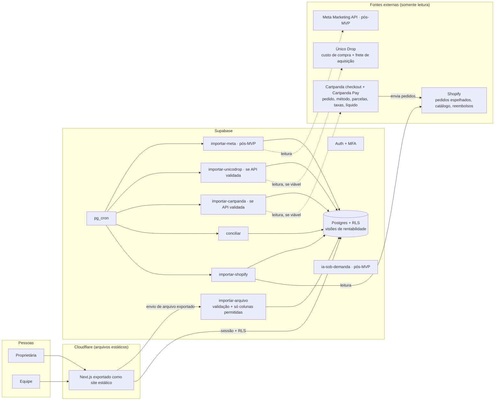

# Rocco OS · arquitetura técnica consolidada (revisão 3)

**Status:** aprovada conceitualmente. **Autorização atual: só a auditoria técnica da Fase 0**, sem implementar integrações e sem alterar sistemas externos. Implementação não autorizada.
**Revisão:** 23/10/2026. Inclui a Único Drop (custos de compra) e o Cartpanda Pay (gateway). As revisões anteriores ficam no histórico do git.
**Andamento da Fase 0:** `docs/rocco-os/auditoria-fase-0.md`.

---

## 0. Como ler este documento

| Marca | Significado |
|---|---|
| **[CONFIRMADO dd/mm]** | Visto em fonte oficial na data. A fonte está na linha ou na seção 15 |
| **[HIPÓTESE]** | Provável, sem evidência suficiente. Traz o teste que confirma ou derruba |
| **[LACUNA]** | Não se sabe. Traz o jeito de descobrir e quem decide |

**Como verifiquei:**
- **Shopify:** busca de documentação oficial e inspeção do esquema GraphQL Admin (versão fixada pelo conector, não informada).
- **Meta, Supabase, Netlify, Cloudflare, GitHub, Anthropic, Cartpanda e Único Drop:** busca restrita aos domínios oficiais. A rede deste ambiente bloqueia o acesso direto a shopify.dev, developers.facebook.com, help.cartpanda.com, dev.cartpanda.com e unicodrop.com.br, então li essas páginas por trechos de busca, e isso está marcado.
- **Único Drop:** o que há é **material de marketing** do próprio site; não encontrei documentação técnica pública.
- **Contas:** nenhuma consulta foi feita aos dados da loja, da Cartpanda, da Único Drop ou da conta de anúncios.

---

## 1. Resumo executivo

**O que muda na revisão 3:**

1. **Custo do produto:** a fonte principal deixa de ser planilha e passa a ser a **Único Drop**, onde os custos de compra e o frete de aquisição já estão. O acesso automatizado **não está confirmado**:
   - pelo site, a API ("documentação e tokens") aparece só no plano Elite;
   - não há documentação pública;
   - não achei exportação documentada.

   A Fase 0 começa por isso. Se não houver API no seu plano, a alternativa é a importação de um arquivo exportado da Único Drop. A planilha manual fica como último recurso.
2. **Taxas de pagamento: a fonte passa a ser a Cartpanda.** Como o checkout é da Cartpanda, a taxa **não vem da Shopify** (`OrderTransaction.fees` só existe para o Shopify Payments, **[CONFIRMADO 23/10]**). A taxa efetiva de cada pedido é a soma de:
   - **MDR do Cartpanda Pay** (varia por método e prazo de recebimento);
   - **tarifa fixa** (ex.: boleto);
   - **taxa de checkout do plano Cartpanda**;
   - **custo de parcelamento**, quando a loja assume os juros;
   - **antecipação**, quando usada.

   Ordem de preferência das fontes:
   - (a) valor observado por pedido na Cartpanda (painel, exportação ou API, a validar);
   - (b) cálculo pelas **suas taxas contratadas**, conciliado todo mês com o líquido recebido.

   Taxas padrão publicadas **nunca** são usadas como definitivas.
3. **Três sistemas a ligar:** Cartpanda (pedido e pagamento), Shopify (pedido espelhado e catálogo) e Único Drop (custos). A chave de ligação entre eles é uma hipótese a validar na Fase 0.
4. **A Fase 0 foi reordenada:** primeiro a viabilidade de obter custos da Único Drop e taxas do Cartpanda Pay. Ela já começou com a pesquisa pública (0A); o resto depende de informações e amostras suas (seção 12).

**Dinheiro no bolso: alerta.** Pelo site, a Único Drop já mostra lucro por pedido e por produto, com custo do produto e frete, taxas de pagamento e gasto da Meta. Se esse número estiver certo, construir a mesma conta no Rocco OS é retrabalho.

A Fase 0 inclui um teste objetivo: conferir 10 pedidos da Único Drop contra o seu cálculo. A decisão D16 depois diz o que o Rocco OS deve fazer: tudo, só o que a Único Drop não faz, ou nada por enquanto.

**Custo mensal no MVP:** US$ 0 de infraestrutura. Upgrade de plano da Único Drop para ter API **não é recomendado** sem antes testar a exportação por arquivo (seção 7.2).

---

## 2. Arquitetura

### 2.1 Diagrama



O fluxo "Cartpanda envia pedidos para a Shopify" está **[CONFIRMADO 23/10, via busca]** na central de ajuda da Cartpanda:
- pedidos finalizados no checkout Cartpanda vão para a Shopify;
- pedidos criados direto na Shopify não voltam para a Cartpanda;
- produtos vão da Shopify para a Cartpanda.

### 2.2 Componentes

| Componente | Escolha | Por quê |
|---|---|---|
| Interface | Next.js + TypeScript, exportação estática na Cloudflare | Sem servidor web, sem limite de execução nem custo; segurança na RLS |
| Backend | Só Supabase (Postgres, Auth, Edge Functions, pg_cron, Storage) | Um lugar para segredos, logs e permissões |
| Shopify | API GraphQL Admin, só leitura | Pedidos, itens, reembolsos e catálogo |
| Cartpanda / Cartpanda Pay | **Arquivo exportado** no MVP; API só se a Fase 0 provar que dá a taxa por pedido **e** que o token pode ser restrito ou controlado (D18) | A API tem campos de pagamento, mas nenhum campo de taxa documentado |
| Único Drop | **Arquivo exportado** no MVP; API só se existir no seu plano, com documentação e escopo de leitura (D17) | Não há API pública; pelo site, ela está no Elite |
| Importação por arquivo | Uma função genérica com **lista de colunas permitidas** por tipo de arquivo. Arquivo com colunas de dados pessoais é rejeitado; o arquivo bruto não é guardado | Evita trabalho manual e não importa dados de clientes |
| Webhooks, filas, microserviços | Não usar | Sem justificativa no volume atual |
| IA | Pós-MVP, uma chamada por pedido, sem ferramentas | Sem agentes autônomos |

**Troca em relação à versão anterior:** com exportação estática não há Server Components nem cookies httpOnly. A sessão do Supabase fica no navegador. Mitigações:
- CSP estrita, sem scripts de terceiros e sem HTML injetado;
- MFA para quem vê finanças;
- toda regra de acesso no banco (seção 6).

Se você preferir sessão em cookie no servidor, a alternativa é a Vercel Pro (US$ 20/mês), na decisão D1.

### 2.3 Princípios
1. O banco é a fonte de verdade; a IA só explica.
2. Só leitura nas integrações. No MVP não existe escopo nem código de escrita externa.
3. Permissão no banco e nas funções, não na interface.
4. Toda linha tem origem rastreada (API, arquivo com hash ou lançamento aprovado), e toda alteração é auditada.
5. Texto e arquivos externos são dados, nunca instrução.
6. **Taxas contratadas prevalecem sobre taxas padrão; valor observado prevalece sobre valor calculado.**

---

## 3. Rentabilidade por produto

### 3.1 Indicadores

| Indicador | Nível | Fórmula |
|---|---|---|
| **Margem de contribuição (MC)** | Item, pedido, produto, dia, mês | Receita líquida de produtos + frete líquido cobrado − CMV (custo de compra + frete de aquisição) − taxas de pagamento e checkout − custo de frete de entrega (se a loja paga) − embalagem − impostos sobre a venda |
| **Resultado após publicidade (RAP)** | Loja; produto só para anúncios ligados (3.4) | MC − gasto de anúncios |
| **Lucro líquido gerencial (LL)** | Só loja e mês | RAP − despesas fixas (planos Shopify, Cartpanda e Único Drop, apps, pessoas, contador, IA…) |

Em dropshipping, o "frete de aquisição" registrado na Único Drop pode ser o próprio frete de envio ao cliente pago ao fornecedor. **[LACUNA R10]**: confirmar o que ele representa para não contar o mesmo frete duas vezes.

### 3.2 Componentes, origem e status

Status de cada componente:

- **confirmado:** valor observado em registro da fonte;
- **parametrizado:** calculado por taxa contratada aprovada, com vigência;
- **pendente:** sem dado.

| Componente | Fonte preferida | Alternativa | Situação |
|---|---|---|---|
| Receita do item, descontos, quantidades | Shopify (`LineItem.priceAfterAllDiscountsBeforeTaxesSet`, `discountAllocations`, `currentQuantity`) | Exportação de pedidos da Cartpanda | **[CONFIRMADO 23/10]** na doc 2026-10; o campo de receita líquida é a hipótese H3 |
| Reembolsos de itens e frete | Shopify (`Refund.*`) | Cartpanda Pay (reembolsos e chargebacks) | **[HIPÓTESE H8]**: reembolso feito no Cartpanda Pay aparece na Shopify. Se não aparecer, a Cartpanda vira a fonte de reembolsos |
| Chargebacks | Cartpanda Pay (painel mostra chargebacks) | — | **[CONFIRMADO 23/10, via busca]** que o painel mostra chargebacks; exportação e API são **[LACUNA]** |
| **Custo de compra do produto** | **Único Drop** | Foto diária do `unitCost` da Shopify (só se a Único Drop gravar o custo lá, H11) → planilha | Ver 3.3 e 4.2 |
| **Frete de aquisição** | **Único Drop** | Planilha | Ver 4.2 e R10 |
| **MDR do Cartpanda Pay** | Taxa por pedido observada na Cartpanda | Taxa contratada × método × prazo × parcelas | Ver 3.6 e 4.3 |
| **Taxa de checkout do plano Cartpanda** | CSV de cobranças da Cartpanda (taxas cobradas por número de pedido) | Percentual do seu plano × pedido pago | **[CONFIRMADO 23/10, via busca]** que existe CSV de taxas cobradas por pedido; colunas exatas são lacuna |
| **Custo de parcelamento assumido pela loja** | Configuração e contrato da Cartpanda | — | **[LACUNA R11]**: a central diz que, por padrão, os juros são pagos pelo comprador; falta saber se você oferece parcelas sem juros |
| **Antecipação** | Extrato do Cartpanda Pay | — | **[LACUNA R12]**: você antecipa? A que custo? |
| **Taxa de transação da Shopify** sobre pedidos de checkout externo | Fatura da Shopify | — | **[LACUNA L20]**: verificar na fatura se existe cobrança por pedido |
| Reserva de 5% por 90 dias | Extrato do Cartpanda Pay | — | **Não é custo**: afeta só o caixa. **[HIPÓTESE]** veio de fonte de terceiros; confirmar no seu contrato |
| Frete de entrega pago pela loja | Único Drop (se for o mesmo frete) ou transportadora | — | R10 |
| Embalagem | Parâmetro aprovado | — | Em dropshipping, provavelmente zero (R13) |
| Impostos sobre a venda | Alíquota do regime | — | **[LACUNA R3]** |
| Gasto de anúncios | Meta API (pós-MVP) | Única Drop, que já lê os gastos da Meta (pelo site) | Pós-MVP |

**Regra do indicador:**
- **Completo:** todos os componentes confirmados ou parametrizados com aprovação vigente. A tela lista os parametrizados.
- **Incompleto:** algum componente pendente. A tela mostra as partes, os pendentes e a cobertura, e **nunca** soma como margem ou lucro.
- Valores médios inventados não entram.

### 3.3 Custo histórico (sem reaproveitar o custo atual)

Ordem das fontes:

1. **Custo por pedido registrado na Único Drop** (o custo que ela usou naquele pedido), se a exportação ou a API trouxer. É a melhor fonte histórica, porque reflete o custo da época. **[HIPÓTESE H9]**: a Único Drop guarda o custo por pedido, e não recalcula pedidos antigos com o custo atual.
2. **Tabela de custos por produto/variante da Único Drop com data**, se houver histórico de alterações. **[LACUNA L21]**.
3. **Fotografias periódicas** da tabela de custos da Único Drop (arquivo ou API) a partir do primeiro dia. Valem só **daquele dia em diante**.
4. **Planilha manual com evidência**, só para o que faltar.

Se a Único Drop só tiver o custo atual e recalcular pedidos antigos com ele, o histórico dela **não serve** como custo histórico. Nesse caso o passado fica pendente ou vai para a planilha.

**Devoluções e CMV** (decisão D7):
- Unidade reembolsada **com volta ao estoque**: reverte o CMV. Em dropshipping, provavelmente não há estoque próprio (R13).
- Unidade reembolsada **sem volta**: mantém o CMV.

### 3.4 Gasto de anúncios por produto
Só por **ligação aprovada** entre anúncio e produto. O que não estiver ligado aparece como "publicidade não alocada". Rateio só com aprovação e sempre rotulado (D8).

### 3.5 Rateios dentro da MC
Taxas, frete e embalagem são do pedido. Para a MC por produto, o rateio é pela receita líquida do item e aparece rotulado (D7).

### 3.6 Cálculo das taxas da Cartpanda quando não há valor observado

```
taxa_pedido = mdr_contratado(método, prazo_recebimento, parcelas) × valor_cobrado
            + tarifa_fixa_contratada(método)
            + custo_parcelamento_loja(parcelas) × valor_cobrado     -- só se a loja assume juros
            + taxa_checkout_plano × valor_pago                       -- se não vier do CSV de cobranças
```

- **Entradas por pedido (método, parcelas, valor cobrado):** vêm da exportação da Cartpanda ou da API. A API documenta `payment_type`, `no_of_installments` e `installments_rate` (**[CONFIRMADO 23/10, via busca]**). O significado exato de `installments_rate` é **[LACUNA]**.
- **Prazo de recebimento:** vem do seu contrato (D+2, D+5 ou D+14). Ele muda o MDR.
- **Juros pagos pelo comprador:** não são receita da loja. Se o total cobrado na Cartpanda incluir juros e o total da Shopify não, a diferença é tratada como repasse e não como venda (**[HIPÓTESE H10]**).
- **Conciliação mensal obrigatória:**
  - **Bruto:** a soma dos valores pagos do mês tem que bater com o "valor bruto" da Cartpanda.
  - **Taxas:** a soma das taxas calculadas é comparada com bruto − líquido na tela Financeiro > Visão Geral do Cartpanda Pay, que mostra o líquido do período já sem as taxas (**[CONFIRMADO 23/10, via busca]**).
  - **Diferença acima de 0,5% do bruto:** os pedidos do mês ficam **incompletos** até a explicação.
- **Taxas padrão da central de ajuda** (ex.: cartão D+14 4,99%, D+2 5,99%, Pix 0,99%, boleto R$ 3,50; checkout de 2,5% a 0,5% conforme o plano) aparecem só como referência. **Não entram no cálculo.**

### 3.7 Datas e fusos
- O pedido entra no dia de `processedAt`, no fuso da loja (`Shop.ianaTimezone`: o campo existe no esquema, **[CONFIRMADO 23/10]**; o valor da loja é lido na Fase 0). O reembolso entra no dia de `Refund.processedAt`. Assim, um mês fechado não muda quando chega um reembolso: o reembolso aparece no mês em que aconteceu (decisão D7).
- O gasto da Meta entra no dia do fuso da conta de anúncios (**[LACUNA L7]**). Se os fusos forem diferentes, o RAP diário fica marcado como "fusos diferentes" até a conversão ser definida.

---

## 4. Fontes de dados

### 4.1 Shopify

#### 4.1.1 Fatos confirmados

| Tema | Fato | Fonte / data |
|---|---|---|
| Criação do app | Não dá mais para criar apps personalizados no admin. Apps novos saem do Dev Dashboard ou da Shopify CLI | shopify.dev, "Generate access tokens for admin-created custom apps" · 22/10 |
| Autenticação | *Client credentials grant*: client ID + secret → token com `expires_in` sempre 86399 s (24 h). O token não pede escopos: lê os escopos da versão do app liberada no Dev Dashboard | shopify.dev, "Authenticate an app for stores in your organization" · 23/10 |
| Pré-requisito | Só funciona quando **o app e a loja estão na mesma organização** do Dev Dashboard. Ser dona da loja não coloca a loja na organização. O erro, se não estiverem, é `shop_not_permitted` | mesma página · 23/10 |
| Tokens expiráveis | A obrigação de 01/01/2027 vale para apps públicos; apps criados pelo lojista não são afetados | changelog Shopify 20/05/2026 · 22/10 |
| Versão | 2026-10 é a última estável, acessível até 16/10/2027. Uma versão por trimestre | shopify.dev, versionamento · 22/10 |
| Pedidos antigos | `read_orders` dá 60 dias. Com `read_all_orders`, todos. App de organização de lojista não precisa de aprovação da Shopify para `read_all_orders` | shopify.dev, access scopes · 22/10 |
| Limite de taxa | Custo por consulta. Standard: 100 pontos/s; Advanced: 200; Plus: 1000. **Uma consulta não pode passar de 1.000 pontos**. A resposta traz `extensions.cost.throttleStatus` | shopify.dev, GraphQL rate limits · 23/10 |
| Paginação | Até 250 itens por página, cursores `after`/`before` | shopify.dev, pagination · 23/10 |
| Filtros de pedidos | `orders(query:)` aceita `updated_at`, `created_at`, `processed_at`, `test`, `status`, `financial_status`. `sortKey` aceita `UPDATED_AT` e `PROCESSED_AT` | esquema via conector · 23/10 |
| Exportação em massa | `bulkOperationRunQuery` aceita até 5 conexões e profundidade de 2 níveis. Resultado em JSONL, que expira em 7 dias. A partir da 2026-01, até **5 operações simultâneas** por loja | shopify.dev, bulk operations · 23/10 |
| Dados protegidos | Nível 1 = dados de cliente sem nome, endereço, telefone e e-mail; nível 2 = com eles. Na tabela da Shopify: app personalizado tem nível 1 e 2 "sempre disponíveis"; app criado no admin, nível 2 "varia por plano" | shopify.dev, protected customer data · 23/10 |
| Webhooks | HMAC em `X-Shopify-Hmac-SHA256`, deduplicar por `X-Shopify-Webhook-Id`, responder 2xx em até 5 s, 8 tentativas em 4 h. Existem os tópicos `orders/edited` e `orders/delete` | shopify.dev · 22–23/10 |
| Custo | `InventoryItem.unitCost` = custo atual. Nenhum campo de custo no pedido ou item | esquema + doc 2026-10 · 23/10 |

#### 4.1.2 Hipóteses (a validar na Fase 0, só com leitura)

| ID | Hipótese | Como validar |
|---|---|---|
| H1 | A loja da Rocco aparece na mesma organização do Dev Dashboard, e o *client credentials grant* funciona | Abrir o Dev Dashboard → "Dev stores"/lojas. Se não aparecer, usar o fluxo *authorization code* (mais trabalho; decisão D3) |
| H2 | O app do Dev Dashboard instalado na loja conta como "app personalizado" na tabela de dados protegidos | Tela de acesso a dados protegidos do app ao criar |
| H3 | `priceAfterAllDiscountsBeforeTaxesSet` está disponível na 2026-10 para este app | Consulta de 1 pedido |
| H4 | Reembolso, edição e cancelamento atualizam `Order.updatedAt` | Em pedidos reais já reembolsados: conferir `updatedAt ≥ refund.processedAt`. Se falhar, a varredura semanal (4.1.4) cobre |
| H5 | Uma exportação em massa com `orders → lineItems` + `refunds → refundLineItems` cabe no limite de conexões e profundidade | Validar a consulta antes de rodar. Se não couber, separar reembolsos numa segunda exportação |
| H6 | O fuso da loja vem de `shop.ianaTimezone` | Esquema `Shop` |
| H7 | `customerJourneySummary.lastVisit.utmParameters` (existe no esquema) pode ser lido sem nível 2 de dados protegidos | Ver o aviso de dados protegidos no tipo; **só pós-MVP** e só se D5 permitir |

#### 4.1.3 Escopos propostos para o MVP

`read_products`, `read_inventory`, `read_orders`, `read_all_orders`. **Nenhum `write_*`.** `read_reports` só se D5 aprovar ShopifyQL.

O critério de aceite lê os escopos efetivamente concedidos do campo `scope` da resposta do token e falha se aparecer qualquer `write_`.

#### 4.1.4 Importação reiniciável, deduplicação, conciliação e alterações

**Dados em duas camadas:**
1. `shopify_registros` (bruto, sem dados pessoais): uma linha por **versão** de pedido ou produto, com chave `(gid, origem_atualizado_em, hash_payload)`. Não guarda campos de cliente porque eles não são pedidos nas consultas; um teste verifica o texto das consultas.
2. Tabelas normalizadas (`pedidos`, `itens_pedido`, `reembolsos`…), sempre reconstruídas a partir da **última versão** de cada gid.

**Carga inicial reiniciável:**
- O período aprovado (D4) é dividido em janelas mensais na tabela `janelas_importacao`, com status `pendente → exportando → baixado → processando → concluida | erro`.
- Cada janela roda uma exportação em massa (`created_at` dentro da janela). O JSONL é copiado para o Storage na hora, porque a URL expira em 7 dias, e é processado em blocos com `linha_checkpoint`.
- Se cair, a janela recomeça do checkpoint. Reprocessar uma janela inteira não muda nada, porque o *upsert* é idempotente.
- Até 5 janelas simultâneas é o limite da Shopify; o sistema usa 2, por folga.

**Incremental (a cada hora):**
- `orders(query: "updated_at:>='<cursor − 15 min>'", sortKey: UPDATED_AT, first: ≤250)`, paginado, respeitando o `throttleStatus`.
- O cursor só avança depois que a página foi gravada, na mesma transação.

**Deduplicação e ordem:**
- Uma versão já existente (mesmo hash) é ignorada.
- Uma versão com `updatedAt` mais antigo que a gravada não substitui a mais nova.
- `unique` em todos os gids.

**Alterações em pedidos:**

| Evento | Tratamento |
|---|---|
| Edição (`Order.edited`) | Nova versão. Itens são recalculados por `currentQuantity`. Itens removidos ficam com quantidade vigente 0, sem apagar a linha |
| Reembolso | Gravado em `reembolsos` e `reembolso_itens` com a data própria. Não altera o mês do pedido |
| Cancelamento | `cancelado_em` preenchido. Sai da receita do dia do cancelamento (D7) |
| Pedido de teste | `teste = true`, fora de todos os indicadores |
| Pedido apagado na loja | Não aparece no incremental. A conciliação detecta a diferença de contagem e marca `removido_na_origem = true` depois de confirmar por consulta direta ao gid |

**Conciliação:**
- **Diária:** para cada um dos últimos 7 dias (fuso da loja), compara contagem de pedidos não-teste e soma de `currentTotalPriceSet` entre a Shopify e o banco. Na Shopify, usa uma consulta paginada só com `id`, `processedAt`, `currentTotalPriceSet`, `test`.
- **Semanal:** a mesma conferência para os últimos 90 dias, mais a releitura completa dos pedidos com reembolso nesse período. Isso cobre o caso de H4 ser falsa.
- Divergência → a janela é reimportada e há alerta na tela "Saúde". A conciliação nunca "corrige" números à mão.
- **Aceite manual:** num mês fechado, os totais do sistema batem com o relatório da Shopify no mesmo filtro (seção 10).

**Retentativas:**
- Erro de limite de taxa ou 5xx: espera exponencial (2, 4, 8, 16, 32 s), até 5 tentativas.
- 401/403: para, desativa a integração e avisa. Não insiste.
- Erro em uma linha: registra, pula e marca a execução como `parcial`.

#### 4.1.5 Campos da Shopify usados no cálculo

| Componente | Origem | Campo ou fonte | Situação da verificação |
|---|---|---|---|
| Valor bruto do item | Shopify | `LineItem.originalUnitPriceSet` × `quantity` | **[CONFIRMADO 23/10]** no esquema |
| Quantidade vigente | Shopify | `LineItem.currentQuantity` ("excluindo unidades reembolsadas e removidas") | **[CONFIRMADO 23/10]** doc 2026-10 |
| Receita líquida do item | Shopify | `LineItem.priceAfterAllDiscountsBeforeTaxesSet` ("depois de todos os descontos, excluindo quantidades reembolsadas e removidas, sem impostos") | **[CONFIRMADO 23/10]** na doc 2026-10. **[HIPÓTESE]** que exista na versão fixada; o esquema do conector não lista o campo. Teste na Fase 0 |
| Descontos do item | Shopify | `LineItem.discountAllocations[].allocatedAmountSet` (inclui descontos de quantidades reembolsadas/removidas) | **[CONFIRMADO 23/10]** |
| Desconto de frete | Shopify | `ShippingLine.discountAllocations` | **[CONFIRMADO 23/10]** (o tipo `DiscountAllocation` é usado em `ShippingLine`) |
| Reembolso de itens | Shopify | `Refund.refundLineItems{quantity, subtotalSet, restockType, lineItem}` | **[CONFIRMADO 23/10]** no esquema |
| Reembolso de frete e ajustes | Shopify | `Refund.refundShippingLines`, `Refund.orderAdjustments`, `Order.totalRefundedShippingSet` | **[CONFIRMADO 23/10]** no esquema |
| Frete cobrado | Shopify | `Order.currentShippingPriceSet` | **[CONFIRMADO 23/10]** no esquema |
| Impostos destacados no pedido | Shopify | `Order.taxesIncluded`, `currentTotalTaxSet`, `LineItem.taxLines` | **[CONFIRMADO 23/10]** no esquema |
| Pedido de teste / cancelado / editado | Shopify | `Order.test`, `cancelledAt`, `edited` | **[CONFIRMADO 23/10]** no esquema |
| **Custo do produto (CMV)** | Ver 3.3 | Pedido e item **não têm campo de custo** | **[CONFIRMADO 23/10]**: `LineItem` não tem campo de custo |
| Taxa do pagamento | Shopify Payments: `OrderTransaction.fees` | Outro gateway: parâmetro por gateway | **[CONFIRMADO 23/10]**: `fees` "só existe para transações do Shopify Payments". O gateway em uso é a lacuna R2 |
| Custo real do frete | Transportadora, Shopify Shipping ou planilha | — | **[LACUNA R9]**: fonte desconhecida. Fica pendente até você escolher |
| Embalagem | Parâmetro por pedido | — | Parametrizado, se você aprovar um valor |
| Impostos sobre a venda | Parâmetro (alíquota do regime) | — | **[LACUNA R3]**: regime e alíquota |
| Gasto de anúncios | Meta Marketing API (`spend`) | — | Pós-MVP. **[HIPÓTESE]** o valor da API pode não incluir impostos cobrados na fatura; conciliar com as faturas (Fase 4) |
| Despesas fixas | Lançamento manual mensal | — | Só para o LL |

Desde a revisão 3, o custo do produto vem da Único Drop (4.2) e a taxa de pagamento vem da Cartpanda (4.3): a Shopify não tem nenhum dos dois para pedidos do checkout Cartpanda.

#### 4.1.6 Custo na Shopify (fonte complementar)

A loja só expõe o custo atual (`InventoryItem.unitCost`, **[CONFIRMADO 23/10]**; leitura com `read_inventory` ou `read_products`, e o usuário precisa da permissão "View product costs" quando permissões granulares estão ativas). A ajuda da Shopify diz que o "custo por item" é estático e que os relatórios de lucro usam o custo registrado no momento da venda (ajuda da Shopify via busca, 23/10; **[HIPÓTESE]** que valha hoje sem mudança).
3. **ShopifyQL (`FROM sales SHOW cost_of_goods_sold`):** o esquema `sales` tem `cost_of_goods_sold`, `gross_profit`, `net_sales_with_cost_recorded` e `net_sales_without_cost_recorded` (**[CONFIRMADO 23/10]**). Para usar, o app precisa do escopo `read_reports`, **acesso nível 2 a dados protegidos de clientes** e API 2025-10 ou mais nova (**[CONFIRMADO 23/10]**). Essa fonte daria o histórico gravado pela Shopify, mas abre acesso a nome, e-mail, telefone e endereço que o sistema não precisa. **Decisão D5.** **[HIPÓTESE]** que o `cost_of_goods_sold` reflita o custo registrado na venda. Teste: comparar com o relatório de lucro do admin num mês fechado.

#### 4.1.7 Hipóteses novas (revisão 3)

| ID | Hipótese | Como validar |
|---|---|---|
| H8 | Reembolsos e cancelamentos feitos no Cartpanda Pay chegam à Shopify | Leitura 0D de pedidos reembolsados + sua resposta sobre onde reembolsa |
| H11 | A Único Drop grava o custo no "custo por item" da Shopify (se gravar, a foto diária do `unitCost` vira fonte complementar) | Leitura 0D do `unitCost` de 5 variantes × telas da Único Drop |
| H12 | O pedido da Shopify carrega um identificador do pedido Cartpanda em `sourceIdentifier`, `sourceName`, `customAttributes`, `tags` ou `name` (os campos existem no esquema, **[CONFIRMADO 23/10]**; o conteúdo é a hipótese) | Leitura 0D |
| H13 | O nome do gateway em `paymentGatewayNames` identifica o Cartpanda Pay | Leitura 0D |

### 4.2 Único Drop (custos de compra e frete de aquisição)

| Item | Situação |
|---|---|
| Integra com Shopify colando as chaves da Shopify no painel; sincroniza "em tempo real" | **[CONFIRMADO 23/10, via busca]** (página da integração Shopify; marketing) |
| Integra com Cartpanda por chave de integração; importa os pedidos e mostra lucro por pedido, taxas aplicadas, custo do produto e resultado por campanha | **[CONFIRMADO 23/10, via busca]** (página da integração Cartpanda; marketing) |
| Lê gastos da Meta (somente leitura; primeira sincronização de 60 dias) | **[CONFIRMADO 23/10, via busca]** (página da integração Facebook; marketing) |
| Dashboard com custo de produto e frete, taxas, margem por pedido; alerta de margem negativa | **[CONFIRMADO 23/10, via busca]** (marketing) |
| **API:** "Acesso à API (documentação e tokens)" listada no **plano Elite**; "pedidos retroativos de até 24 meses" no mesmo plano | **[CONFIRMADO 23/10, via busca]** que aparece na página de planos. **Não há documentação pública**: endpoints, escopos, campos e limites são **[LACUNA L22]** |
| Nomes e preços dos planos | **Divergentes entre páginas** (ex.: Growth R$ 139/139,90; Elite R$ 289; Ultra R$ 399,90). **[LACUNA R14]**: seu plano atual |
| Exportação de pedidos ou custos (CSV/Excel) | **[LACUNA L23]**: nada documentado |
| Como o custo é cadastrado: por produto ou variante, com ou sem frete separado, com histórico | **[LACUNA L21]** |
| Se o lucro da Único Drop usa a taxa real da Cartpanda ou um percentual configurado | **[LACUNA L24]** |
| Se a Único Drop guarda o custo do pedido na data da venda | **[HIPÓTESE H9]** |
| Como os produtos da Único Drop se ligam às variantes da Shopify (ID da Shopify ou SKU) | **[HIPÓTESE H14]**: como ela importa da Shopify, deve guardar o ID da variante ou o SKU |

**Conclusão provisória:** não dá para afirmar que existe API acessível. O caminho com menos trabalho e sem custo extra é:
1. Fase 0: descobrir se a tela de pedidos ou de produtos da Único Drop exporta arquivo com custo por pedido ou por variante.
2. Se exportar, a importação por arquivo (4.6) resolve o MVP.
3. Se não exportar e só houver API no Elite, compare o custo do upgrade com o tempo da planilha (D17).

### 4.3 Cartpanda e Cartpanda Pay (pedido, pagamento e taxas)

| Item | Situação |
|---|---|
| API pública "CartX", autenticação por *bearer token* da loja; v1 `accounts.cartpanda.com/api/{loja}/orders` com filtro por status e por data de atualização; v3 em `accounts.cartpanda.com/api/v3` | **[CONFIRMADO 23/10, via busca]** (dev.cartpanda.com) |
| Campos de pagamento do pedido: `payment_gateway`, `payment_gateway_id`, `payment_type` (`cc`, `boleto`, `admin`), `payment_status` (1 pendente, 3 pago, 4 cancelado), `no_of_installments`, `installments_rate`, `total_price` (texto com vírgula), `unformatted_total_price` (em centavos, pelo exemplo), `subtotal_price`, `total_discounts`, `total_tax` | **[CONFIRMADO 23/10, via busca]**. A doc v1 não lista Pix em `payment_type`; a v3 é **[LACUNA]** |
| **Campo de taxa, valor líquido ou data de liberação no pedido da API** | **Não documentado.** **[LACUNA L25]** |
| Escopo do token (só leitura?) | **[LACUNA L26]**. Se o token também puder escrever (há endpoints de atualização de pedido e de *fulfillment*), usar a API fere o menor privilégio. Ver D18 |
| Painel do Cartpanda Pay: valor bruto, valor líquido, **taxas por pedido**, reserva, chargebacks, reembolsos, saldo; em Pedidos, "recebível do gateway" = bruto − taxas do Cartpanda Pay; o Financeiro mostra só valores efetivamente pagos | **[CONFIRMADO 23/10, via busca]** (central de ajuda, "Analisando dados no Cartpanda Pay") |
| Exportação de pedidos em CSV (Pedidos > Todos os pedidos, com filtro por gateway) e app "Exportação Avançada" (Excel/CSV com colunas escolhidas) | **[CONFIRMADO 23/10, via busca]**. Se "recebível do gateway" ou taxa entra nas colunas é **[LACUNA L27]** |
| CSV das **taxas cobradas pela Cartpanda** com número do pedido e valor (área de cobranças) | **[CONFIRMADO 23/10, via busca]** (artigo "Gerencie as cobranças CartPanda") |
| Exportação do extrato do Cartpanda Pay | **[LACUNA L28]**: não encontrei |
| Taxas e prazos padrão (cartão D+14/D+5/D+2; Pix; boleto; checkout por plano) e regra de que os juros de parcelamento são pagos pelo comprador | **[CONFIRMADO 23/10, via busca]** como **padrão publicado**. **Não usados no cálculo**: valem as suas taxas contratadas (R2) |
| Reserva de 5% dos recebíveis por 90 dias | **[HIPÓTESE]**: aparece em fonte de terceiros e em termos não lidos por inteiro |

**Conclusão provisória:** a taxa **por pedido** existe no painel. Ainda não se sabe se ela sai em arquivo ou pela API. Ordem de tentativa na Fase 0:
1. Exportação Avançada de pedidos com as colunas de taxa e recebível.
2. CSV de cobranças (taxa de checkout por pedido).
3. API de pedidos, para ver se traz a taxa.
4. Se nada disso trouxer a taxa por pedido: cálculo pelas taxas contratadas (3.6), com conciliação mensal contra o líquido do painel.

### 4.4 Ligação entre os três sistemas

```
Cartpanda (pedido + pagamento) ──► Shopify (pedido espelhado)
         │                                 │
         └──────► Único Drop ◄─────────────┘  (custos; ligada às duas)
```

- **Chave proposta:** número do pedido Cartpanda ↔ pedido Shopify. A Fase 0 descobre onde o número aparece na Shopify (H12) e na exportação da Único Drop.
- A tabela `vinculos_pedido` guarda o par, o método de ligação (identificador exato, número do pedido ou valor+data) e a confiança. Ligações sem identificador exato precisam de revisão.
- Produto: variante da Shopify ↔ produto/variante da Único Drop, por ID da Shopify ou SKU (H14). Itens sem ligação ficam com custo pendente e aparecem na tela "Pendências".

### 4.5 Importação reiniciável, deduplicação e conciliação

**Shopify:** ver 4.1.4. Em resumo:
- camada bruta versionada;
- carga inicial em janelas mensais com checkpoint;
- incremental por `updated_at` com sobreposição de 15 minutos;
- versão velha nunca sobrescreve a nova;
- conciliação diária (7 dias) e semanal (90 dias).

**Arquivos** (Único Drop e Cartpanda):
- Cada envio vira um registro em `importacoes_arquivo` com o **hash SHA-256** do conteúdo. O mesmo arquivo enviado de novo é recusado, porque já foi importado.
- Cada linha tem uma **chave natural**: número do pedido + tipo de taxa no CSV de cobranças; número do pedido na exportação de pedidos; identificador do produto + data da foto na tabela de custos. O *upsert* por essa chave faz com que arquivos com período sobreposto não dupliquem.
- **Validação antes de gravar:**
  - cabeçalho igual ao layout esperado;
  - tipos e formato de número (vírgula decimal);
  - datas;
  - **colunas proibidas** (nome, e-mail, telefone, endereço, CPF), que levam à rejeição do arquivo inteiro com mensagem clara.
- Gravação em transação única por arquivo. Se falhar, nada entra, e o relatório de erros diz linha por linha o que corrigir.
- O arquivo bruto **não é guardado**. Guardam-se o hash, o nome, o período coberto, as contagens e as linhas aceitas.

**Conciliações entre fontes** (mensal, ao fechar o mês):

| Comparação | Tolerância | Se falhar |
|---|---|---|
| Pedidos pagos: Cartpanda × Shopify (contagem e soma) | Exata, ou cada diferença explicada (juros de parcelamento, H10) | Mês marcado "não conciliado" |
| Taxas: Σ taxas por pedido (observadas ou calculadas) × (bruto − líquido) do Cartpanda Pay | ≤ 0,5% do bruto | Taxas do mês ficam pendentes |
| Custos: pedidos com custo da Único Drop × pedidos da Shopify | Cobertura informada (%) | Itens sem custo ficam pendentes |
| Lucro por pedido: Único Drop × Rocco OS (amostra de 10) | Explicar cada diferença | Entra na decisão D16 |

### 4.6 Alternativa por arquivo

Usada se não houver acesso automatizado. Os layouts abaixo são os **mínimos**; se a exportação real da plataforma trouxer as colunas com outros nomes, o sistema mapeia. O que importa é o conteúdo.

**A. Custos da Único Drop** (preferência: exportação da própria Único Drop; senão, este layout)

| Coluna | Obrigatória | Observação |
|---|---|---|
| `sku` ou `shopify_variant_id` | Sim | Liga à variante |
| `custo_compra_unitario` | Sim | R$ |
| `frete_aquisicao_unitario` | Se existir separado | R$ |
| `vigente_desde` | Sim | Data em que o custo passou a valer |
| `fonte` | Sim | "Único Drop exportação", "nota fiscal", etc. |

**B. Custo por pedido da Único Drop** (se a exportação de pedidos trouxer custo, este é o preferido)

| Coluna | Obrigatória |
|---|---|
| `numero_pedido` (Cartpanda ou Shopify) | Sim |
| `data_pedido` | Sim |
| `custo_produtos` | Sim |
| `frete` | Se existir |
| por item: `sku` + `quantidade` + `custo_unitario` | Desejável (permite MC por produto) |

**C. Pedidos da Cartpanda** (Exportação Avançada, só estas colunas, **sem colunas de cliente**)

| Coluna | Obrigatória |
|---|---|
| `numero_pedido` | Sim |
| `data_pagamento` | Sim |
| `status_pagamento` | Sim |
| `metodo_pagamento` (cartão, Pix, boleto) | Sim |
| `parcelas` | Sim |
| `valor_bruto` | Sim |
| `taxa_gateway` e/ou `recebivel_gateway` | **Se existir: torna a taxa "confirmada"** |
| `valor_reembolsado`, `chargeback` | Se existir |

**D. Cobranças da Cartpanda** (CSV de taxas cobradas): `numero_pedido`, `valor`, `tipo`/`descricao`, `data`.

**E. Taxas contratadas** (só se C não trouxer a taxa por pedido). Uma linha por combinação:

| Coluna | Exemplo |
|---|---|
| `metodo` | cartao, pix, boleto |
| `prazo_recebimento` | D+2, D+5, D+14 |
| `parcelas_de`, `parcelas_ate` | 1, 1 · 2, 6 · 7, 12 |
| `mdr_percentual` | do **seu** painel |
| `tarifa_fixa` | R$ |
| `juros_assumidos_loja_percentual` | 0 se o comprador paga os juros |
| `taxa_checkout_percentual` | do **seu** plano |
| `vigente_desde` | data |
| `evidencia` | captura da tela "Gerenciar" do Cartpanda Pay ou contrato |

---

## 5. Meta Ads (pós-MVP, só leitura)

### 5.1 Princípio
O Rocco OS terá **o próprio app Meta e o próprio usuário do sistema** (*system user*), só com `ads_read`.
- **Não reutiliza** o token do conector Meta das sessões do Claude, que tem ferramentas de escrita.
- **Não reutiliza** nenhum token com `ads_management`.

### 5.2 O que está confirmado e o que não está

| Item | Situação |
|---|---|
| `ads_read` permite ler o Ads Insights de contas próprias ou concedidas; é pré-requisito do Insights | **[CONFIRMADO 22–23/10, via busca]** Permissions Reference e Ads Insights |
| `ads_management` cria e altera anúncios: **não pedir** | **[CONFIRMADO 22/10, via busca]** |
| Versão atual v26.0 (29/07/2026) | **[CONFIRMADO 22/10, via busca]** |
| Token de *system user*: expirável de 60 dias ou sem expiração. Remover o app em "Apps conectados" invalida | **[CONFIRMADO 22/10, via busca]**. Proposta: token de 60 dias com rotação |
| Limites por conta de anúncio e caso de uso; cabeçalho `X-Business-Use-Case-Usage`; erros 17/613 | **[CONFIRMADO 22/10, via busca]**. Os números exatos dos níveis divergem entre páginas: **[LACUNA L5]** |
| App Review só para dados que você não possui ou gerencia | **[HIPÓTESE]** veio de trecho de busca. Confirmar no painel do app |
| Papel mínimo do *system user* na conta de anúncios para ler métricas | **[LACUNA L16]**. Confirmar nas Configurações do Negócio na Fase 4 |
| Como ler os escopos concedidos ao token (Access Token Debugger / `debug_token`) | **[HIPÓTESE]**. O endpoint existe (doc WhatsApp via busca), mas o retorno de escopos para *system user* não foi confirmado. Na Fase 4, conferir também pela ferramenta visual da Meta |
| Moeda da conta de anúncios (BRL ou USD) | **[LACUNA L17]**. Ler `currency` da conta na Fase 4. Se não for BRL, a conversão vira decisão |

**Aceite de permissão (Fase 4):** os escopos lidos do token contêm `ads_read` e **nenhum** `ads_management`, `business_management` ou outro de escrita. Se a Meta exigir mais algum escopo só para leitura, ele é registrado aqui com a fonte antes de ser pedido.

### 5.3 Limitações de atribuição

Fontes: Central de Ajuda da Meta e doc de Insights, via busca (22–23/10).

- **Só eventos atribuídos:** o Gerenciador mostra apenas eventos ligados a alguém que viu ou clicou no anúncio, segundo a janela escolhida.
- **Janela:** muda o número. A janela padrão aparece diferente em páginas diferentes (há página que diz 7 dias clique + 1 dia visualização e página que diz 1 dia visualização + 28 dias clique). **Não confiar no padrão:** pedir `action_attribution_windows` explicitamente e gravar a janela em cada linha.
- **Conversões modeladas:** em alguns casos a Meta usa modelagem estatística para conversões que não consegue medir diretamente (iOS 14.5+). Ou seja, parte das "compras" da Meta é estimativa.
- **Data:** a Meta pode atribuir a conversão ao dia da impressão ou do clique. Desde junho de 2025 ela ignora `action_report_time` em alguns casos e responde como o Gerenciador (*mixed*).
- **Mudança de definição:** em março de 2026, o clique para conversões no site passou a contar só cliques no link. Isso pode deslocar séries históricas.
- **As compras atribuídas mudam depois do dia.** Por isso os últimos 7 dias são relidos diariamente e os últimos 28, semanalmente. O tamanho certo da janela é a lacuna L8.

### 5.4 Meta × Shopify

| | Meta (compras atribuídas) | Shopify (vendas confirmadas) |
|---|---|---|
| O que conta | Eventos do pixel/CAPI atribuídos a alguém exposto ao anúncio, incluindo visualização e modelagem | Pedidos efetivamente feitos, com reembolsos e cancelamentos |
| Pode contar a mesma venda em outro canal? | Sim (outros canais também se atribuem a venda) | Não |
| Reflete reembolso e cancelamento? | Não necessariamente | Sim |
| Entra no cálculo de lucro? | **Não.** Só o `spend` (gasto) entra | **Sim** (receita) |

Na tela, "ROAS segundo a Meta" (valor de compras da Meta ÷ gasto) fica separado de "receita Shopify ÷ gasto". Um nunca corrige o outro.

**Novo:** a Único Drop já lê gastos da Meta (pelo site). Se ela atender (D16), o Rocco OS pode até dispensar a integração própria com a Meta. Isso só se decide depois da Fase 0.

---

## 6. Segurança, usuários, agentes e ferramentas

### 6.1 Papéis de pessoas

| Recurso | Proprietária | Gestor | Operador | Leitor (ex.: contador) |
|---|---|---|---|---|
| Painéis de vendas (agregados) | L | L | L | L |
| Pedidos e itens (detalhe, sem dados pessoais) | L | L | — | L |
| Margem e rentabilidade | L | L | — (D10) | L |
| Custos e parâmetros financeiros | L, E (direto, auditado) | L, **propõe** (vai para aprovação) | — | L |
| Ligação anúncio → produto (pós-MVP) | L, E | L, propõe | — | L |
| Despesas fixas (LL) | L, E | L | — | L |
| Usuários e papéis | L, E (exige MFA) | — | — | — |
| Teto de IA (pós-MVP) | L, E (exige MFA) | L | — | — |
| Pedir análise de IA (pós-MVP) | Sim | Sim (D10) | — | — |
| Saúde das integrações e logs | L | L | — | — |
| Auditoria | L | — | — | — |

L = ler · E = criar/editar · — = sem acesso.

### 6.2 Identidades técnicas

| Identidade | Como existe | O que pode | O que não pode |
|---|---|---|---|
| `importador_shopify` | Edge Function com chave secreta própria | Ler a Shopify; escrever em `shopify_registros`, tabelas espelho, `execucoes_sync` | Tocar em custos, parâmetros, papéis, decisões; ler segredos de outras funções |
| `importador_meta` (pós-MVP) | Idem, chave própria | Ler a Meta; escrever em `meta_*`, `execucoes_sync` | Idem |
| `ia_sob_demanda` (pós-MVP) | Edge Function chamada **com o JWT de quem pediu** | Ler as visões que **essa pessoa** pode ler; registrar a execução e propostas `pendente` por RPC | Escrever em qualquer tabela financeira ou espelho; aprovar; chamar API externa que não seja a do Claude |
| `backup` | GitHub Actions com URL do banco em segredo | `supabase db dump` (leitura) | Escrever no banco |

Cada função tem a **própria chave secreta** (o Supabase permite várias), para que um vazamento seja rotacionado sem derrubar as outras.

### 6.3 Ferramentas da IA (pós-MVP)

A IA **não recebe ferramentas** na primeira versão. O servidor monta o contexto a partir de visões permitidas, envia, recebe texto e, opcionalmente, propostas estruturadas (validadas por esquema). Se um dia houver ferramentas, cada uma entra na tabela `permissoes_ferramenta` com o efeito declarado, e só ferramentas de leitura são permitidas sem nova aprovação de arquitetura.

### 6.4 Ações críticas bloqueadas no backend

Ação crítica é aquela que muda dinheiro, acesso ou dado de terceiros:
- alterar custo ou parâmetro proposto por quem não é a proprietária;
- alterar papel;
- alterar o teto de IA;
- apagar dados;
- **qualquer escrita externa** (inexistente no MVP).

Regras impostas pelo banco, não pela interface:
1. Não existe `grant update/delete` direto nessas tabelas para usuários autenticados. Só funções `security definer` com `search_path` vazio fazem a mudança.
2. Uma ação proposta vira um registro em `decisoes` com `payload` e `hash_payload`. A aprovação grava `aprovado_por`, `aprovado_em`, `valida_ate` (7 dias) e exige:
   - papel `proprietaria`;
   - sessão com MFA (**[LACUNA L10]**: confirmar o claim `aal` no JWT);
   - aprovador diferente do proponente.
3. A execução passa por `executar_decisao(id)`, que confere:
   - status `aprovada` e prazo válido;
   - o mesmo `hash_payload` aprovado, para que ninguém troque o conteúdo depois;
   - transição atômica `aprovada → executando`, para que a decisão só execute uma vez.

   O resultado vai para `acoes_executadas`.
4. Testes pgTAP provam cada recusa (seção 10).

### 6.5 O que fica registrado

| Registro | Conteúdo |
|---|---|
| `execucoes_sync` | Integração, recurso, janela, status, contagens, custo de API (throttle), erro |
| `janelas_importacao` | Progresso reiniciável da carga inicial |
| `execucoes_ia` | Quem pediu, finalidade, modelo, versão do prompt, entradas (referências), tokens, custo reservado e real, status (incluindo `bloqueada_teto`), erro |
| `decisoes` | Proposta, quem propôs, aprovação ou rejeição, motivo, validade |
| `acoes_executadas` | O que foi feito, quando, resultado, erro |
| `auditoria` | Antes e depois de toda alteração em tabelas de negócio, por trigger; só inserção |

### 6.6 Segredos
- Client secret da Shopify, token Meta e chave da API do Claude ficam nos **segredos das Edge Functions**. Nunca no repositório, na interface, em `NEXT_PUBLIC_*` ou em tabela.
- O token da Shopify vive só na memória da função, renovado a cada execução (24 h).
- A URL do banco para backup fica nos segredos do GitHub Actions. O backup é **criptografado** antes de ir para o repositório privado (chave pública no repositório, chave privada só com você).
- No CI: gitleaks, *secret scanning* do GitHub e `.env*` no `.gitignore`.

### 6.7 Arquivos, Cartpanda e Único Drop

| Tema | Regra |
|---|---|
| Envio de arquivos | Só `proprietaria` e `gestor`. A função valida o tamanho (máx. 10 MB), o tipo (CSV/XLSX) e as colunas permitidas por layout. Rejeita colunas pessoais. Não guarda o arquivo bruto. Registra hash, quem enviou e o resultado |
| Token da Cartpanda (se D18 aprovar API) | Guardado nos segredos da função. A função só faz `GET` em uma lista fixa de rotas, e qualquer outro método é bloqueado no código, com teste. Como o escopo do token não está confirmado (L26), a decisão de usar um token que também escreve é sua |
| Token da Único Drop (se D17 aprovar API) | Mesma regra |
| Conectores do Claude | O Rocco OS não usa conectores do Claude. Os dados só entram por API própria de leitura ou por arquivo |
| Edição de taxas contratadas e custos | Proprietária direto (auditado); gestor só propõe (D10) |

---

## 7. Infraestrutura

### 7.1 Reavaliação

| Serviço | Uso comercial | Disponibilidade | Limites relevantes | Backup e recuperação | Veredito |
|---|---|---|---|---|---|
| **Netlify Free** | Permitido (página da Netlify e resposta da equipe no fórum) | Sem SLA conhecido. Ao esgotar 300 créditos/mês, **todos os projetos da equipe pausam** até o mês seguinte, e não dá para comprar créditos no Free. Há relatos de 2026 no fórum de pausa que continuou após a renovação (relatos de usuários, não confirmação oficial) | Deploy de produção: 15 créditos; funções: 10 créditos/GB-hora; banda: 20/GB; requisições: 2 por 10 mil | Não se aplica (só interface) | **Descartado.** O risco de pausa total não compensa |
| **Cloudflare (arquivos estáticos)** | **[LACUNA L18]**: não li os termos | Sem SLA para o Free **[não verificado]** | Requisições a arquivos estáticos **gratuitas e ilimitadas**; Worker Free só se houver código de servidor (100 mil/dia, 10 ms CPU), e o desenho não usa | O site é reconstruído do git a qualquer momento | **Recomendado** (D1) |
| **Vercel Hobby** | **Proibido** (termos) | — | — | — | Descartado |
| **Vercel Pro** | Permitido | — | US$ 20/mês | — | Só se você quiser sessão em cookie de servidor (D1) |
| **Supabase Free** | Não encontrei proibição nos trechos dos termos; **não li os termos completos** (**[LACUNA L19]**) | **Sem SLA** (SLA só no Enterprise). Pausa após 7 dias de pouca atividade | 500 MB de banco (acima disso, só leitura); 5 GB de saída; 2 projetos; Edge Functions: 500 mil invocações/mês, 2 s de CPU e 150 s de relógio por requisição | **Sem backup automático.** Guia oficial: dump diário via GitHub Actions; restauração com `psql` em projeto novo. Storage não entra no dump | **Mantido no MVP**, com backup próprio e gatilhos de troca (7.2) |
| **Supabase Pro** | Permitido | Não pausa | US$ 25/mês; 8 GB de disco; 2 milhões de invocações | Backup diário guardado 7 dias | Só por gatilho (7.2) |
| **GitHub Free** | — | — | 2.000 minutos de Actions/mês em repositórios privados; 500 MB de artefatos. Com limite de gasto em US$ 0, as Actions param ao esgotar, sem cobrança | O próprio git | Mantido |

**Recuperação no Supabase Free (proposta):**
- **Perda máxima aceitável de dados:** 24 h, porque o backup é diário. Os dados da Shopify e da Meta podem ser reimportados. O que só existe no Rocco OS são custos, parâmetros, ligações, decisões e auditoria.
- **Tempo para voltar:** algumas horas, porque a restauração em projeto novo é manual.
- **Ensaio de restauração mensal:** restaurar o último dump num projeto de teste e rodar a conciliação. Fica registrado em `docs/runbooks/`.

### 7.2 Quando vale pagar (gatilhos objetivos, nada antes)

| Gatilho | Ação | Custo |
|---|---|---|
| O projeto pausar uma vez em uso real **ou** o banco passar de 350 MB (70% do limite) **ou** você exigir perda máxima menor que 24 h | Supabase Pro | US$ 25/mês |
| O CPU de 2 s das Edge Functions impedir a importação, mesmo com blocos menores | Supabase Pro (mais limite) ou reduzir o bloco | US$ 25/mês |
| Único Drop: **sem exportação** com custo **e** você atualizando custos por arquivo mais de 1 h/mês **e** API confirmada no Elite, com documentação e escopo de leitura | Upgrade para o plano com API | Diferença entre o seu plano e o Elite: **[LACUNA R14]** (as páginas divergem) |
| Você preferir sessão em cookie de servidor | Vercel Pro | US$ 20/mês |
| O GitHub Actions passar de 2.000 min/mês | Otimizar o CI primeiro; só depois pagar | — |

### 7.3 Limite de consumo da IA (pós-MVP)

São quatro barreiras independentes:

1. **Reserva no banco antes de chamar.** A função `reservar_orcamento_ia()` trava a linha do mês (`select … for update`) e calcula o **teto do custo da chamada**:
   - tokens de entrada contados pela API de contagem de tokens × preço de entrada;
   - mais `max_tokens` × preço de saída.

   Se `gasto_confirmado + reservado + teto_da_chamada > teto_mensal`, grava `bloqueada_teto` e **não chama**. Depois da resposta, `liquidar_execucao_ia()` troca a reserva pelo custo real (`usage`). Chamadas simultâneas não estouram o teto, porque a reserva é atômica.
2. **Limite por chamada:** `max_tokens` fixo por finalidade e um número máximo de chamadas por pessoa por dia.
3. **Chave desligável:** `ia_habilitada = false` bloqueia tudo imediatamente.
4. **Limite do workspace no Console da Anthropic:** workspace exclusivo "rocco-os" com limite mensal igual ao teto. Ao atingir, a API devolve erro 400 ("You have reached your specified workspace API usage limits"). **[CONFIRMADO 23/10, via busca]** em platform.claude.com e support.claude.com. Não dá para pôr limite no workspace padrão, por isso precisa ser um workspace próprio.

**Premissa do cálculo:** `max_tokens` limita os tokens de saída, incluindo os de raciocínio (**[HIPÓTESE]**; confirmar na doc antes da Fase 5). Os preços ficam na tabela `precos_modelo_ia` com a data e a fonte. Preço sem fonte conferida não é usado.

---

## 8. Modelo de dados atualizado

Esboço. Nas migrations, a ordem segue as dependências. Convenções:
- `uuid`, `timestamptz` (UTC), dinheiro `numeric(14,2)` + `moeda char(3)`;
- **sem colunas de dados pessoais de clientes**, com teste automático que falha se alguma aparecer;
- RLS em todas as tabelas.

### 8.1 Acesso, integrações e importação

```sql
create type papel as enum ('proprietaria','gestor','operador','leitor');

create table perfis (
  id uuid primary key references auth.users(id) on delete cascade,
  nome text not null,
  papel papel not null default 'leitor',
  ativo boolean not null default true,
  criado_em timestamptz not null default now()
);
create unique index perfis_uma_proprietaria on perfis ((papel)) where papel = 'proprietaria' and ativo;

create table integracoes (
  id uuid primary key default gen_random_uuid(),
  provedor text not null check (provedor in ('shopify','meta','anthropic')),
  conta_externa text not null,               -- loja.myshopify.com, act_..., workspace
  versao_api text not null,
  escopos_concedidos text[] not null default '{}',  -- lidos da resposta do token
  fuso text,                                  -- fuso da loja / da conta
  moeda char(3),
  ativa boolean not null default true,
  verificado_em timestamptz,
  unique (provedor, conta_externa),
  check (not exists_escrita(escopos_concedidos))   -- função: falha se houver write_* / ads_management
);

create table execucoes_sync (
  id uuid primary key default gen_random_uuid(),
  integracao_id uuid not null references integracoes(id),
  recurso text not null,                      -- pedidos, produtos, custos_foto, conciliacao, insights
  modo text not null check (modo in ('carga_inicial','incremental','conciliacao','releitura')),
  janela_de timestamptz, janela_ate timestamptz,
  status text not null check (status in ('rodando','ok','parcial','erro')),
  lidos int default 0, novos int default 0, alterados int default 0, ignorados int default 0,
  custo_api jsonb, erro text,
  iniciado_em timestamptz not null default now(), terminado_em timestamptz
);
create unique index execucoes_sync_uma_rodando on execucoes_sync (integracao_id, recurso) where status = 'rodando';
create index on execucoes_sync (integracao_id, recurso, iniciado_em desc);

create table janelas_importacao (
  id uuid primary key default gen_random_uuid(),
  integracao_id uuid not null references integracoes(id),
  recurso text not null,
  inicio timestamptz not null, fim timestamptz not null,
  status text not null default 'pendente'
    check (status in ('pendente','exportando','baixado','processando','concluida','erro')),
  operacao_externa_id text,                   -- id da bulk operation
  arquivo_storage text,                       -- cópia do JSONL
  linha_checkpoint bigint not null default 0,
  tentativas int not null default 0,
  erro text,
  unique (integracao_id, recurso, inicio, fim),
  check (fim > inicio)
);

create table cursores_sync (
  integracao_id uuid references integracoes(id),
  recurso text,
  atualizado_ate timestamptz not null,
  primary key (integracao_id, recurso)
);

create table shopify_registros (               -- camada bruta, versionada, sem dados pessoais
  id bigint generated always as identity primary key,
  tipo text not null check (tipo in ('pedido','produto','variante')),
  gid text not null,
  origem_atualizado_em timestamptz not null,
  hash_payload text not null,
  payload jsonb not null,
  execucao_sync_id uuid references execucoes_sync(id),
  recebido_em timestamptz not null default now(),
  unique (gid, origem_atualizado_em, hash_payload)
);
create index on shopify_registros (gid, origem_atualizado_em desc);
```

### 8.2 Catálogo e vendas (normalizado a partir da última versão)

```sql
-- bloco de origem presente nas tabelas abaixo:
--   origem_atualizado_em timestamptz not null, sincronizado_em timestamptz not null default now(),
--   registro_id bigint references shopify_registros(id)

create table produtos (
  id uuid primary key default gen_random_uuid(),
  shopify_gid text not null unique,
  handle text not null, titulo text not null, status text not null
  /* + bloco de origem */
);

create table variantes (
  id uuid primary key default gen_random_uuid(),
  produto_id uuid not null references produtos(id),
  shopify_gid text not null unique,
  inventory_item_gid text unique,
  sku text, titulo text not null,
  preco_atual numeric(14,2) not null check (preco_atual >= 0)
  /* + bloco de origem */
);
create index on variantes (produto_id);
create index on variantes (sku);

create table pedidos (
  id uuid primary key default gen_random_uuid(),
  shopify_gid text not null unique,
  numero text not null,
  processado_em timestamptz not null,         -- processedAt: define o dia do pedido
  criado_em_loja timestamptz not null,
  cancelado_em timestamptz,
  teste boolean not null,
  editado boolean not null,
  removido_na_origem boolean not null default false,
  moeda char(3) not null,
  impostos_incluidos boolean not null,        -- taxesIncluded
  subtotal_atual numeric(14,2) not null,      -- currentSubtotalPriceSet
  descontos_atuais numeric(14,2) not null,    -- currentTotalDiscountsSet
  frete_atual numeric(14,2) not null,         -- currentShippingPriceSet
  impostos_atuais numeric(14,2) not null,     -- currentTotalTaxSet
  total_atual numeric(14,2) not null,         -- currentTotalPriceSet
  total_reembolsado numeric(14,2) not null,   -- totalRefundedSet
  frete_reembolsado numeric(14,2) not null,   -- totalRefundedShippingSet
  gateways text[] not null default '{}',      -- paymentGatewayNames
  canal text                                  -- sourceName
  /* + bloco de origem */
);
create index on pedidos (processado_em) where not teste;

create table itens_pedido (
  id uuid primary key default gen_random_uuid(),
  pedido_id uuid not null references pedidos(id) on delete cascade,
  shopify_gid text not null unique,
  variante_id uuid references variantes(id),  -- null se a variante não existe mais
  sku text,
  quantidade_original int not null check (quantidade_original >= 0),  -- quantity
  quantidade_atual int not null check (quantidade_atual >= 0),         -- currentQuantity
  preco_unitario_original numeric(14,2) not null,                      -- originalUnitPriceSet
  descontos_alocados numeric(14,2) not null default 0,                 -- soma discountAllocations
  receita_liquida_atual numeric(14,2),        -- priceAfterAllDiscountsBeforeTaxesSet (H3)
  check (quantidade_atual <= quantidade_original)
);
create index on itens_pedido (pedido_id);
create index on itens_pedido (variante_id);

create table reembolsos (
  id uuid primary key default gen_random_uuid(),
  pedido_id uuid not null references pedidos(id) on delete cascade,
  shopify_gid text not null unique,
  processado_em timestamptz not null,
  total numeric(14,2) not null check (total >= 0)
);
create index on reembolsos (processado_em);

create table reembolso_itens (
  id uuid primary key default gen_random_uuid(),
  reembolso_id uuid not null references reembolsos(id) on delete cascade,
  item_pedido_id uuid not null references itens_pedido(id),
  quantidade int not null check (quantidade > 0),
  subtotal numeric(14,2) not null,
  tipo_reposicao text not null                -- restockType
);

create table transacoes_pagamento (
  id uuid primary key default gen_random_uuid(),
  pedido_id uuid not null references pedidos(id) on delete cascade,
  shopify_gid text not null unique,
  gateway text, tipo text not null, status text not null,   -- kind, status
  valor numeric(14,2) not null,
  taxa_observada numeric(14,2),               -- soma de fees (só Shopify Payments); null = não informada
  processado_em timestamptz
);
```

### 8.3 Custos, parâmetros e despesas

```sql
create extension if not exists btree_gist;

create table custos_variante (
  id uuid primary key default gen_random_uuid(),
  variante_id uuid not null references variantes(id),
  custo_unitario numeric(14,2) not null check (custo_unitario >= 0),
  vigencia daterange not null,
  fonte text not null check (fonte in ('manual','shopify_foto','shopifyql')),
  evidencia text,                             -- nota, planilha, id da execução
  aprovado_por uuid references perfis(id),    -- obrigatório para 'manual'
  check (fonte <> 'manual' or aprovado_por is not null),
  exclude using gist (variante_id with =, vigencia with &&)
);

create table fotos_custo_shopify (            -- leitura diária do unitCost atual
  variante_id uuid not null references variantes(id),
  capturado_em date not null,
  custo_unitario numeric(14,2),               -- null = sem custo na Shopify
  primary key (variante_id, capturado_em)
);

create table parametros_financeiros (
  id uuid primary key default gen_random_uuid(),
  chave text not null,      -- 'taxa_gateway:<nome>:percentual', 'taxa_gateway:<nome>:fixa', 'aliquota_venda', 'embalagem_pedido'
  valor numeric(12,4) not null check (valor >= 0),
  unidade text not null check (unidade in ('percentual','brl')),
  vigencia daterange not null,
  fonte text not null,                        -- contrato, contador, etc.
  aprovado_por uuid not null references perfis(id),
  exclude using gist (chave with =, vigencia with &&)
);

create table custos_frete (                   -- fonte a definir (R9)
  pedido_id uuid primary key references pedidos(id),
  valor numeric(14,2) not null check (valor >= 0),
  fonte text not null, evidencia text,
  registrado_por uuid references perfis(id)
);

create table despesas_mes (                   -- só para o lucro líquido gerencial
  id uuid primary key default gen_random_uuid(),
  mes date not null check (extract(day from mes) = 1),
  categoria text not null, descricao text not null,
  valor numeric(14,2) not null check (valor >= 0),
  fonte text not null,
  registrado_por uuid not null references perfis(id)
);
create index on despesas_mes (mes);
```

**Visões de rentabilidade** (versionadas e testadas):
- `vw_componentes_item`: cada componente do item com `valor` e `status` (`confirmado`, `parametrizado`, `pendente`) e a `fonte`.
- `vw_margem_contribuicao_pedido`, `vw_margem_contribuicao_produto_dia`: somam só quando nenhum componente está pendente; senão devolvem `completo = false`, a lista de pendências e a cobertura.
- `vw_resultado_apos_publicidade_dia` (pós-MVP), `vw_lucro_liquido_mes` (pós-MVP).

### 8.4 Meta (pós-MVP)

```sql
create table meta_campanhas (id uuid primary key default gen_random_uuid(), meta_id text not null unique, nome text not null, status text not null, objetivo text /* + origem */);
create table meta_conjuntos (id uuid primary key default gen_random_uuid(), meta_id text not null unique, campanha_id uuid not null references meta_campanhas(id), nome text not null, status text not null /* + origem */);
create table meta_anuncios  (id uuid primary key default gen_random_uuid(), meta_id text not null unique, conjunto_id uuid not null references meta_conjuntos(id), nome text not null, status text not null /* + origem */);

create table meta_insights_diarios (
  id uuid primary key default gen_random_uuid(),
  nivel text not null check (nivel in ('campanha','conjunto','anuncio')),
  objeto_meta_id text not null,
  data date not null,                         -- fuso da conta
  janela_atribuicao text not null,
  gasto numeric(14,2) not null default 0,
  moeda char(3) not null,
  impressoes bigint not null default 0, cliques bigint not null default 0,
  compras_atribuidas numeric(12,2), valor_compras_atribuidas numeric(14,2),  -- só informativo
  buscado_em timestamptz not null default now(),
  unique (nivel, objeto_meta_id, data, janela_atribuicao)
);
create index on meta_insights_diarios (data);

create table ligacoes_anuncio_produto (       -- metodologia A
  id uuid primary key default gen_random_uuid(),
  meta_objeto_id text not null,               -- anúncio ou campanha
  nivel text not null check (nivel in ('campanha','anuncio')),
  produto_id uuid not null references produtos(id),
  vigencia daterange not null,
  aprovado_por uuid not null references perfis(id),
  exclude using gist (meta_objeto_id with =, vigencia with &&)
);
```

### 8.5 Decisões, ações, IA e auditoria

```sql
create table decisoes (
  id uuid primary key default gen_random_uuid(),
  tipo text not null, titulo text not null, justificativa text not null,
  payload jsonb not null, hash_payload text not null,
  critica boolean not null,
  proposta_por uuid not null references perfis(id),
  execucao_ia_id uuid,                        -- fk para execucoes_ia
  status text not null default 'pendente'
    check (status in ('pendente','aprovada','rejeitada','expirada','executando','executada','falhou')),
  decidido_por uuid references perfis(id), decidido_em timestamptz, motivo text,
  valida_ate timestamptz,
  criado_em timestamptz not null default now(),
  check (status in ('pendente','expirada') or decidido_por is not null),
  check (decidido_por is null or decidido_por <> proposta_por),
  check (status not in ('aprovada','executando','executada') or valida_ate is not null)
);
create index decisoes_pendentes on decisoes (criado_em) where status = 'pendente';

create table acoes_executadas (
  id uuid primary key default gen_random_uuid(),
  decisao_id uuid not null unique references decisoes(id),   -- executa uma vez
  hash_payload text not null,
  iniciado_em timestamptz not null default now(), terminado_em timestamptz,
  resultado jsonb, erro text
);

create table orcamento_ia (
  mes date primary key,
  teto_usd numeric(10,2) not null check (teto_usd >= 0),
  gasto_confirmado_usd numeric(10,4) not null default 0,
  reservado_usd numeric(10,4) not null default 0,
  ia_habilitada boolean not null default true,
  aprovado_por uuid not null references perfis(id)
);

create table precos_modelo_ia (
  modelo text not null, vigencia daterange not null,
  entrada_usd_mtok numeric(10,4) not null, saida_usd_mtok numeric(10,4) not null,
  fonte text not null, conferido_em date not null,
  exclude using gist (modelo with =, vigencia with &&)
);

create table execucoes_ia (
  id uuid primary key default gen_random_uuid(),
  solicitado_por uuid not null references perfis(id),
  finalidade text not null, modelo text not null, versao_prompt text not null,
  entradas jsonb not null,                    -- referências a visões e períodos
  max_tokens int not null, reserva_usd numeric(10,4) not null,
  tokens_entrada int, tokens_saida int, custo_real_usd numeric(10,4),
  status text not null check (status in ('bloqueada_teto','bloqueada_desligada','reservada','ok','erro')),
  saida text, erro text,
  criado_em timestamptz not null default now()
);
create index on execucoes_ia (criado_em);

create table permissoes_ferramenta (           -- vazia na primeira versão da IA
  ferramenta text not null, papel papel not null,
  efeito text not null check (efeito in ('leitura')),
  primary key (ferramenta, papel)
);

create table auditoria (
  id bigint generated always as identity primary key,
  em timestamptz not null default now(),
  ator uuid, ator_tipo text not null,         -- pessoa, funcao:<nome>
  acao text not null, tabela text not null, registro_id text,
  antes jsonb, depois jsonb
);
create index on auditoria (tabela, registro_id);
create index on auditoria (em);
-- só inserção: revoke update, delete on auditoria from authenticated, anon, service_role
```

### 8.6 Cartpanda, Único Drop e arquivos (revisão 3)

```sql
-- integracoes.provedor passa a aceitar 'cartpanda' e 'unicodrop'
alter table integracoes drop constraint integracoes_provedor_check;
alter table integracoes add check (provedor in ('shopify','meta','anthropic','cartpanda','unicodrop'));

create table importacoes_arquivo (
  id uuid primary key default gen_random_uuid(),
  tipo text not null check (tipo in (
    'unicodrop_custos_produto','unicodrop_custos_pedido',
    'cartpanda_pedidos','cartpanda_cobrancas','cartpanda_extrato',
    'taxas_contratadas','custos_manual')),
  nome_arquivo text not null,
  hash_sha256 text not null unique,           -- mesmo arquivo não entra duas vezes
  periodo_de date, periodo_ate date,
  enviado_por uuid not null references perfis(id),
  enviado_em timestamptz not null default now(),
  linhas_lidas int not null default 0, linhas_aceitas int not null default 0, linhas_rejeitadas int not null default 0,
  status text not null check (status in ('validando','rejeitado','importado','erro')),
  relatorio_erros jsonb
);

create table pagamentos_cartpanda (           -- um registro por pedido Cartpanda
  id uuid primary key default gen_random_uuid(),
  cartpanda_pedido text not null unique,      -- número/id do pedido na Cartpanda
  pago_em timestamptz,
  status_pagamento text not null,
  metodo text not null check (metodo in ('cartao','pix','boleto','outro')),
  parcelas int not null default 1 check (parcelas >= 1),
  taxa_juros_parcelas numeric(8,4),           -- installments_rate (significado: lacuna)
  valor_bruto numeric(14,2) not null,
  taxa_gateway_observada numeric(14,2),       -- null = não informada pela fonte
  recebivel_observado numeric(14,2),          -- "recebível do gateway"
  valor_reembolsado numeric(14,2) not null default 0,
  chargeback boolean not null default false,
  origem text not null check (origem in ('api','arquivo')),
  importacao_id uuid references importacoes_arquivo(id),
  atualizado_em timestamptz not null default now()
);
create index on pagamentos_cartpanda (pago_em);

create table taxas_cobradas_cartpanda (        -- CSV de cobranças (taxa de checkout etc.)
  id uuid primary key default gen_random_uuid(),
  cartpanda_pedido text not null,
  tipo text not null,                         -- descrição da cobrança
  valor numeric(14,2) not null,
  cobrado_em date,
  importacao_id uuid not null references importacoes_arquivo(id),
  unique (cartpanda_pedido, tipo)
);

create table taxas_contratadas (               -- só as SUAS taxas; nunca as padrão
  id uuid primary key default gen_random_uuid(),
  provedor text not null check (provedor in ('cartpanda_pay','cartpanda_checkout','shopify')),
  metodo text not null,
  prazo_recebimento text,                     -- D+2, D+5, D+14
  parcelas_de int not null default 1, parcelas_ate int not null default 1,
  mdr_percentual numeric(8,4) not null default 0,
  tarifa_fixa numeric(14,2) not null default 0,
  juros_assumidos_loja_percentual numeric(8,4) not null default 0,
  vigencia daterange not null,
  evidencia text not null,                    -- captura ou contrato
  aprovado_por uuid not null references perfis(id),
  check (parcelas_ate >= parcelas_de),
  exclude using gist (provedor with =, metodo with =, prazo_recebimento with =,
                      int4range(parcelas_de, parcelas_ate, '[]') with &&, vigencia with &&)
);

create table vinculos_pedido (
  pedido_id uuid primary key references pedidos(id),         -- Shopify
  cartpanda_pedido text unique references pagamentos_cartpanda(cartpanda_pedido),
  metodo_vinculo text not null check (metodo_vinculo in ('identificador','numero','valor_data')),
  revisado_por uuid references perfis(id),
  check (metodo_vinculo = 'identificador' or revisado_por is not null)  -- ligação fraca exige revisão
);

-- custos_variante: novas fontes e frete de aquisição separado
alter table custos_variante drop constraint custos_variante_fonte_check;
alter table custos_variante add check (fonte in ('unicodrop_api','unicodrop_arquivo','shopify_foto','manual'));
alter table custos_variante add column frete_aquisicao_unitario numeric(14,2) check (frete_aquisicao_unitario >= 0);
alter table custos_variante add column importacao_id uuid references importacoes_arquivo(id);

create table custos_pedido_unicodrop (         -- custo histórico por pedido, se a Único Drop fornecer
  id uuid primary key default gen_random_uuid(),
  numero_pedido text not null,
  item_sku text,                              -- null = custo do pedido inteiro
  quantidade int,
  custo_produtos numeric(14,2) not null check (custo_produtos >= 0),
  frete_aquisicao numeric(14,2) check (frete_aquisicao >= 0),
  origem text not null check (origem in ('api','arquivo')),
  importacao_id uuid references importacoes_arquivo(id),
  unique (numero_pedido, item_sku)
);
```

`unique (numero_pedido, item_sku)` não impede duplicata quando `item_sku` é null; na migration isso vira um índice único com `coalesce(item_sku, '')`.

**Visões:**
- `vw_taxas_pedido`: escolhe a taxa por pedido nesta ordem: observada (`pagamentos_cartpanda`) → cobranças (`taxas_cobradas_cartpanda`) → calculada (`taxas_contratadas` × método × prazo × parcelas), e marca o status.
- `vw_cmv_item`: `custos_pedido_unicodrop` → `custos_variante` vigente na data → pendente.
- `vw_conciliacao_mensal_cartpanda`: bruto, taxas e líquido versus o painel.

---

## 9. Orçamento e premissas

| Item | Valor/mês | Classificação |
|---|---|---|
| Supabase Free, Cloudflare estático, GitHub Free | US$ 0 | Confirmado (fontes oficiais, via busca), com as lacunas de termos L18/L19 |
| APIs Shopify e Meta | US$ 0 | Não verificado (L2) |
| **API da Cartpanda** | US$ 0 adicional | **Não verificado**: parece incluída na plataforma; confirmar |
| **API da Único Drop** | Diferença até o plano Elite | **Não verificado** (R14); **não recomendado** antes de testar arquivo |
| **Planos que você já paga** (Shopify, Cartpanda, Único Drop) | Já existentes | Entram como despesa fixa no lucro líquido; não são custo do Rocco OS |
| IA (pós-MVP) | ~US$ 2, teto US$ 5 | Estimativa |
| **Total do MVP** | **US$ 0** | — |

**Premissas:**
- até 50 pedidos/dia (R6);
- 24 meses de histórico;
- até 5 usuários;
- arquivos mensais;
- banco abaixo de 150 MB em 24 meses (estimativa sem medição).

**Custo que não aparece na fatura:** o seu tempo para exportar arquivos. A meta é no máximo 15 min por mês: duas a quatro exportações e um envio.

---

## 10. Fases e critérios de aceite

### Fase 0 · Auditoria técnica (**autorizada**; sem integração e sem alterar sistemas externos)

Ordem de prioridade (detalhe e andamento em `auditoria-fase-0.md`):

| Etapa | O que | Quem | Situação |
|---|---|---|---|
| **0A** | Pesquisa pública: Único Drop, Cartpanda/Cartpanda Pay, Shopify | Claude | **Concluída em 23/10** |
| **0B** | **Único Drop:** plano atual; telas de custo; exportação (formato e colunas); custo por pedido x por variante; histórico; frete de aquisição; API no seu plano; como o lucro dela calcula as taxas | Você (telas e amostras) + pergunta ao suporte (texto pronto) | Aguardando você |
| **0C** | **Cartpanda Pay:** taxas contratadas (tela "Gerenciar"); prazo; parcelamento; antecipação; Exportação Avançada com coluna de taxa; CSV de cobranças; extrato; escopo do token de API | Você + suporte (texto pronto) | Aguardando você |
| **0D** | **Shopify, só leitura pelo conector**, consultas exatas listadas na auditoria, sem dados pessoais: H1, H3, H6, H8, H11, H12, H13; cobertura do `unitCost` | Claude, **depois do seu OK específico para essas leituras** | Aguardando OK |
| **0E** | Teste da Único Drop: 10 pedidos, lucro dela × cálculo manual | Você + Claude | Depois de 0B e 0C |
| **0F** | Ambiente: Docker (L9), claim `aal` (L10), termos Supabase e Cloudflare (L18, L19) | Claude | Pode ser feito sem acesso às suas contas |

**Aceite da Fase 0:**
- `auditoria-fase-0.md` com cada hipótese e lacuna marcada como confirmada ou derrubada, com evidência.
- Para custos e taxas, uma conclusão entre **API viável / arquivo viável / só manual**, com o trabalho mensal estimado para você.
- Recomendação D16 baseada no teste 0E.
- Nenhuma escrita em sistema externo.

### Fase 1 · Fundação
- Repositório, CI (lint, typecheck, Vitest, pgTAP, gitleaks), migrations de acesso, auditoria, decisões e integrações; login por convite + MFA; site estático publicado.
- **Testes:**
  - pgTAP de cada célula da matriz 6.1, com casos positivos e negativos;
  - toda tabela com RLS;
  - `auditoria` recusa `update`/`delete`;
  - `decisoes` recusa autoaprovação e execução sem aprovação válida ou com hash diferente;
  - teste de colunas proibidas (dados pessoais).
- **Aceite:**
  - CI verde;
  - 100% das regras da matriz cobertas por teste;
  - gitleaks sem achados;
  - login com MFA funcionando no celular (captura do Playwright, viewport 390 px).

### Fase 2 · Importação Shopify + validação
- App no Dev Dashboard com os escopos de 4.1.3; carga inicial por janelas; incremental; conciliação diária e semanal; foto diária do custo; tela "Saúde".
- **Testes:**
  - unitários de transformação, com payloads gravados e sem dados pessoais;
  - idempotência: rodar duas vezes não muda nada;
  - ordem: versão velha não sobrescreve nova;
  - retomada: matar no meio e retomar do checkpoint;
  - limite de taxa: espera e não falha;
  - consultas sem campos de cliente.
- **Aceite:**
  - escopos concedidos sem nenhum `write_`;
  - em **3 meses fechados** escolhidos por você, a contagem de pedidos não-teste e a soma de vendas batem **exatamente** com o relatório da Shopify no mesmo filtro e fuso, ou cada diferença tem explicação documentada linha a linha;
  - conciliação diária sem divergência por 7 dias seguidos;
  - carga inicial completa interrompida de propósito e retomada sem duplicar.
- **Acréscimos da revisão 3:**
  - Também importa **arquivos** da Cartpanda (pedidos e cobranças) e da Único Drop (custos), ou API se a Fase 0 aprovar. Liga os pedidos entre os sistemas.
  - **Testes:**
    - mesmo arquivo recusado (hash);
    - períodos sobrepostos sem duplicar;
    - arquivo com coluna pessoal rejeitado inteiro;
    - vírgula decimal;
    - vínculo fraco exige revisão.
  - **Aceite:**
    - os 3 meses fechados também conciliados Cartpanda × Shopify (contagem e soma, ou cada diferença explicada);
    - ≥ 95% dos pedidos pagos com vínculo Cartpanda ↔ Shopify por identificador; o restante revisado.

### Fase 3 · Custos e margem de contribuição → **fim do MVP**
- Cadastro de custo com vigência (planilha) e aprovação; parâmetros; visões de componentes e de MC; tela por produto e período com status completo ou incompleto.
- **Testes** (casos fixos calculados à mão):
  - desconto de pedido;
  - desconto de frete;
  - reembolso parcial com e sem reposição;
  - edição que remove item;
  - cancelamento;
  - custo que muda no meio do mês;
  - pedido sem custo (deve ficar incompleto);
  - Shopify Payments com `fees` e outro gateway com parâmetro.
- **Aceite:**
  - para **10 pedidos** escolhidos por você, cada componente e a MC batem com o seu cálculo, centavo a centavo;
  - nenhum indicador incompleto aparece como margem;
  - o custo atual nunca é aplicado a pedido anterior à vigência (teste);
  - a cobertura de custo do período aparece na tela.
- **Acréscimos da revisão 3:**
  - **Testes:**
    - cartão em 1x e parcelado;
    - Pix;
    - boleto;
    - parcelado sem juros assumido pela loja (se houver);
    - taxa observada × calculada;
    - mês fora da tolerância de conciliação de taxas, que deve ficar incompleto;
    - custo por pedido da Único Drop × custo por variante com vigência.
  - **Aceite:**
    - **taxas de 3 meses conciliadas** com o líquido do Cartpanda Pay dentro de 0,5%;
    - nenhuma taxa padrão usada (teste: sem `taxas_contratadas`, as taxas ficam pendentes).

### Fase 4 · Meta Ads, só leitura (pós-MVP; talvez dispensável se a Único Drop atender, D16)
- App Meta próprio e *system user* com `ads_read`; estrutura, insights e releituras; ligações anúncio → produto; RAP da loja e RAP direto por produto; conciliação com faturas.
- **Aceite:**
  - escopos do token sem escrita;
  - gasto diário de 7 dias igual ao Gerenciador, na mesma conta, fuso e período;
  - gasto da API × fatura do mês com a diferença explicada (impostos);
  - gasto não ligado aparece como "não alocado";
  - "ROAS segundo a Meta" separado da receita Shopify.

### Fase 5 · IA sob demanda (pós-MVP)
- **Aceite:**
  - toda chamada gera `execucoes_ia` com reserva e custo real;
  - com teto de US$ 0,01 a chamada é bloqueada **sem** ir à API (teste com servidor falso);
  - `ia_habilitada = false` bloqueia;
  - a IA não consegue escrever em nenhuma tabela financeira (teste pgTAP com o JWT de cada papel);
  - toda resposta cita as visões e o período.

### Fase 6 em diante (adiado)
Fila de decisões com execução, criativos × vendas, webhooks e qualquer escrita externa. Cada uma depende de nova aprovação. **Publicação e alteração de anúncios não estão no plano.**

### Critérios de aceite do MVP (atualizados)
1. Fase 0 concluída com evidência, incluindo a conclusão API/arquivo/manual para custos e taxas.
2. CI verde com testes de permissão positivos e negativos.
3. Nenhum segredo no repositório; nenhum escopo ou método de escrita externa em uso (teste por integração).
4. Nenhuma coluna ou arquivo com dados pessoais aceito.
5. Três meses fechados conciliados: Shopify × relatório Shopify e Cartpanda × Shopify.
6. Taxas de três meses conciliadas com o líquido do Cartpanda Pay (≤ 0,5%).
7. Importação reiniciável provada (API) e deduplicação de arquivos provada.
8. Dez pedidos com MC conferida por você, centavo a centavo.
9. Indicadores incompletos nunca exibidos como margem ou lucro.
10. Nenhum custo atual aplicado a período anterior à sua vigência; nenhuma taxa padrão usada.
11. Backup diário criptografado e uma restauração de ensaio feita.

---

## 11. Decisões técnicas: justificativa, fonte e lacuna

| # | Decisão | Justificativa | Fonte (data) | Lacuna restante |
|---|---|---|---|---|
| T1 | Next.js estático + Cloudflare | Sem servidor web: sem limite de execução nem custo; segurança no banco | Cloudflare static assets (23/10); Vercel termos (22/10); Netlify créditos e pausa (23/10) | Termos comerciais da Cloudflare (L18) |
| T2 | Supabase Free no MVP, Pro por gatilho | Cabe nos limites; backup por dump oficial | Supabase pricing, backups, pausa (22–23/10) | Termos completos (L19); se o pg_cron evita a pausa (L13) |
| T3 | Backup diário criptografado via Actions | Free não tem backup | Guia oficial Supabase (23/10) | — |
| T4 | Só leitura na Shopify; 4 escopos | Menor privilégio | Access scopes (22/10) | — |
| T5 | *Client credentials grant* | Sem fluxo de redirecionamento | Shopify client credentials (23/10) | Loja na organização (H1) |
| T6 | Camada bruta versionada + tabelas reconstruídas | Edições e reembolsos sem perder histórico; reprocessável | Decisão de projeto | — |
| T7 | Exportação em massa por janelas mensais com checkpoint | Reiniciável; respeita o limite de 5 simultâneas | Bulk operations (23/10) | Formato da consulta (H5) |
| T8 | Incremental por `updated_at` + conciliação diária e semanal | Não depende de webhooks; cobre H4 | Esquema `orders` (23/10); recomendação da Shopify de conciliar (22/10) | H4 |
| T9 | Sem webhooks no MVP | Menos superfície | — | — |
| T10 | CMV só com custo vigente na data | O custo atual não é histórico | `unitCost` (23/10); ajuda Shopify (23/10) | Cobertura real de custos (Fase 0) |
| T11 | ShopifyQL fora, salvo aprovação | Exige dados protegidos nível 2 | ShopifyQL GraphQL Admin (23/10) | D5 |
| T12 | Gasto Meta por produto só por ligação aprovada | Sem rateio implícito | Decisão de método | D8 |
| T13 | Só `spend` da Meta entra no resultado | Compras da Meta são atribuídas ou modeladas | Ajuda Meta (23/10) | Impostos na fatura (Fase 4) |
| T14 | App Meta próprio, `ads_read` | Não herdar escrita do conector | Permissions (22–23/10) | L5, L16 |
| T15 | IA pós-MVP, uma chamada, sem ferramentas | Sem agentes autônomos | Pedido da proprietária | — |
| T16 | Teto de IA com reserva no banco + limite do workspace | Bloqueio antes da chamada; segunda barreira externa | Limites do Console (23/10) | `max_tokens` inclui raciocínio (hipótese) |
| T17 | Ações críticas só por função com aprovação válida, hash e uso único | Bloqueio no backend | Decisão de projeto | Claim `aal` (L10) |
| T18 | Custo vem da Único Drop, de preferência **por pedido** | Reflete o custo da época sem trabalho manual | Páginas da Único Drop, via busca (23/10) | H9, L21, L23 |
| T19 | Taxas vêm da Cartpanda: observado > calculado por contrato; nunca padrão | Pedido da proprietária; Shopify não tem `fees` fora do Shopify Payments | Esquema Shopify (23/10); ajuda Cartpanda via busca (23/10) | L25, L27, L28 |
| T20 | Conciliação mensal de taxas com o líquido do Cartpanda Pay (≤ 0,5%) | Prova que o cálculo bate com o dinheiro recebido | Painel "Visão Geral" mostra o líquido (23/10) | Exportação do valor do painel |
| T21 | Arquivo antes de API para Cartpanda e Único Drop no MVP | Sem custo extra; sem token com escrita; cobre o caso de não haver API | — | L22, L26 |
| T22 | Importação por arquivo com hash, chave natural, colunas permitidas e transação única | Sem duplicar, sem dados pessoais, sem meio arquivo gravado | Decisão de projeto | — |
| T23 | Vínculo entre pedidos com nível de confiança e revisão obrigatória dos fracos | Os três sistemas têm números próprios | — | H12 |
| T24 | Teste comparativo com o lucro da Único Drop antes de construir | Evita retrabalho de algo que você já paga | Marketing da Único Drop (23/10) | L24 |

---

## 12. Decisões e informações que dependem de você

### 12.1 Decisões

| ID | Decisão | Opções | Recomendação |
|---|---|---|---|
| D1 | Hospedagem da interface | Cloudflare estático (US$ 0) · Vercel Pro (US$ 20, sessão em cookie de servidor) | **Cloudflare estático** |
| D2 | Região do Supabase | São Paulo (se disponível) · outra | **São Paulo** (L15) |
| D3 | Se a loja não estiver na organização do Dev Dashboard (H1 falsa) | Fluxo *authorization code* · mover a loja · parar | Decidir após a Fase 0 |
| D4 | Histórico a importar | 12 · 24 meses · tudo | **24 meses** |
| D5 | ShopifyQL para custo histórico gravado pela Shopify | Sim (pede `read_reports` + dados protegidos nível 2, ou seja, acesso a nome, e-mail, telefone e endereço que o sistema não usa) · Não (custo histórico manual + foto diária) | **Não**, a menos que a Fase 0 mostre que não existe outra fonte de custo histórico |
| D6 | Custo histórico que a Único Drop não tiver | Planilha/notas · deixar pendente | Planilha só para os produtos que mais vendem; o resto pendente |
| D7 | Regras de cálculo | Devolução com e sem reposição (3.3), rateio por receita (3.5), mês do reembolso e do cancelamento (3.7) | Como proposto |
| D8 | Gasto de anúncios por produto | Só ligação direta · ligação + rateio rotulado | **Só ligação direta** |
| D9 | Teto de IA (pós-MVP) | US$ 2 · US$ 5 · US$ 10 | **US$ 5** |
| D10 | Acesso da equipe | Operador vê margem? Gestor pede IA? Gestor edita custo direto ou só propõe? | Operador **não** vê margem; gestor **propõe**, você aprova |
| D11 | Login | Google · link mágico por e-mail | Google + MFA |
| D12 | Backup no Free | Dump criptografado diário no repositório privado · Supabase Pro desde já | **Dump criptografado**; Pro só por gatilho |
| D13 | Meta Ads entra no MVP? | Não (Fase 4) · Sim | **Não**: margem primeiro |
| D14 | Retenção de registros | Brutos 24 meses; execuções 1 ano; auditoria, decisões e IA 5 anos | Como proposto |
| D15 | Conector Meta do Claude, que tem escrita | Liberado · só leitura sem pedido explícito | **Só leitura** sem pedido explícito |
| D16 | Papel do Rocco OS em relação à Único Drop | Fazer toda a conta · fazer só o que a Único Drop não faz (conciliação de taxas, custo histórico, aprovações) · pausar e usar a Único Drop | **Decidir depois do teste 0E** |
| D17 | Acesso aos custos da Único Drop | Arquivo exportado · API (talvez exija upgrade) · planilha | **Arquivo**, se a exportação existir |
| D18 | Acesso à Cartpanda | Arquivo (pedidos + cobranças) · API com token cujo escopo pode incluir escrita, controlado por código | **Arquivo** no MVP; API só se o token puder ser só de leitura ou se você aceitar o risco por escrito |
| D19 | Tolerância da conciliação de taxas | 0,5% · 1% · exata | **0,5%** do bruto mensal |
| D20 | Fonte principal de pedidos | Shopify (com Cartpanda para pagamento) · Cartpanda | **Shopify**, salvo se H8/H12 falharem |

### 12.2 O que você precisa fornecer (Fase 0)

**Único Drop:**
1. Nome do seu plano atual.
2. Capturas de tela, sem dados de clientes:
   - cadastro do custo de um produto (todos os campos);
   - um pedido mostrando o custo e o lucro;
   - menu de relatórios ou exportação.
3. Se houver exportação: **um arquivo de exemplo de um mês fechado**, de pedidos e de produtos, com as colunas de cliente apagadas antes de enviar.
4. Respostas suas:
   - o custo é por produto ou por variante?
   - o frete de aquisição é separado?
   - quando você muda um custo, os pedidos antigos mudam junto?
   - o que é exatamente esse frete (R10)?
5. Enviar ao suporte a pergunta pronta em `auditoria-fase-0.md` e repassar a resposta.

**Cartpanda / Cartpanda Pay:**
1. Captura de **Admin > Pagamentos > Cartpanda Pay > Gerenciar**: suas taxas por método e prazo, prazo escolhido e antecipação.
2. Configuração de parcelamento:
   - máximo de parcelas;
   - parcelas sem juros oferecidas;
   - quem paga os juros.
3. Nome do seu plano Cartpanda (define a taxa de checkout).
4. Arquivos de exemplo de um mês fechado:
   - **Exportação Avançada de pedidos** com as colunas da seção 4.6-C (incluindo qualquer coluna de taxa ou recebível que aparecer na lista) e **sem colunas de cliente**;
   - **CSV de cobranças** (taxas cobradas por pedido);
   - extrato do Cartpanda Pay, se houver exportação.
5. Os totais do mesmo mês na tela Financeiro > Visão Geral: bruto, líquido, reembolsos, chargebacks.
6. Onde você faz reembolsos (Cartpanda ou Shopify).
7. Enviar ao suporte a pergunta pronta e repassar a resposta.

**Shopify:**
1. OK específico para as leituras da etapa 0D (lista exata na auditoria).
2. Uma captura da fatura da Shopify mostrando se há "taxas de transação" (L20).

**Perguntas ainda abertas:**
- **R3:** regime de imposto e alíquota.
- **R6:** pedidos por dia.
- **R1:** quantas pessoas na equipe e com quais funções.
- **R13:** há estoque próprio ou é tudo dropshipping?

---

## 13. Riscos

| Risco | Impacto | Mitigação |
|---|---|---|
| Custos históricos não existem em lugar nenhum | Margem do passado fica incompleta | Mostrar a cobertura; começar a foto diária cedo; preencher os produtos que mais vendem primeiro |
| H1 falsa (loja fora da organização) | Mais trabalho de autenticação | Fase 0 antes de qualquer código |
| Supabase Free pausa ou perde dado | Sistema parado; perda de até 24 h do que é manual | Dump diário + ensaio; gatilho para Pro |
| Mudança trimestral das APIs | Importação quebra | Versão fixada; teste de contrato a cada versão; alerta de importação parada |
| Meta ≠ Shopify | Decisão errada de verba | Só `spend` no resultado; telas separadas; janela explícita |
| Gasto Meta sem impostos da fatura | RAP otimista | Conciliar com faturas na Fase 4 |
| Sessão no navegador (site estático) | Roubo de sessão por XSS | CSP estrita, sem terceiros, MFA, RLS como barreira final |
| Custo de IA fugir | Gasto sem OK | Reserva atômica + limite no Console + chave desligável |
| Escopo crescer antes de a margem estar certa | Tempo sem retorno | MVP fechado na Fase 3; nova aprovação por fase |
| Único Drop sem exportação nem API no seu plano | Custos voltam para planilha | Arquivo de custos por variante com vigência, atualizado só quando o custo muda |
| Único Drop recalcula pedidos antigos com o custo atual | Histórico falso | Teste em 0B; usar só fotos a partir da captura |
| Taxa por pedido só existe na tela da Cartpanda, sem exportação | Taxas ficam calculadas, não observadas | Cálculo por contrato + conciliação mensal com o líquido (0,5%) |
| Token da Cartpanda com permissão de escrita | Violação do menor privilégio | Arquivo no MVP (D18) |
| Juros de parcelamento contados como receita | Margem inflada | H10 testada; juros pagos pelo comprador excluídos da receita |
| Vínculo errado entre pedidos | Custo ou taxa no pedido errado | Vínculo por identificador; os fracos exigem revisão |
| Construir o que a Único Drop já faz | Tempo sem retorno | Teste 0E e D16 antes da Fase 1 |

---

## 14. Lacunas e como fechar

| ID | Lacuna | Como fechar | Quando |
|---|---|---|---|
| L2 | Tarifa das APIs Shopify e Meta | Termos ao criar os apps | Fases 0 e 4 |
| L5 | Nomes e limites dos níveis de acesso da Meta | Painel do app | Fase 4 |
| L7 | Fuso da conta de anúncios | Campo da conta | Fase 4 |
| L8 | Por quantos dias as compras atribuídas mudam | Comparar leituras diárias por 4 semanas | Fase 4 |
| L9 | Docker no ambiente do Claude Code | `docker info` | Fase 0 |
| L10 | Claim `aal` no JWT (MFA) | Doc de MFA do Supabase | Fase 0 |
| L13 | Se o pg_cron conta como atividade para evitar a pausa | Doc ou suporte do Supabase | Fase 0 |
| L14 | Preços de IA na página oficial | Página de preços da Anthropic | Fase 5 |
| L15 | Região São Paulo no Supabase | Tela de criação | Fase 1 |
| L16 | Papel mínimo do *system user* na conta de anúncios | Configurações do Negócio | Fase 4 |
| L17 | Moeda da conta de anúncios | Campo da conta | Fase 4 |
| L18 | Termos da Cloudflare para uso comercial no Free | Ler os termos | Fase 0 |
| L19 | Termos completos do Supabase (Free comercial) | Ler os termos | Fase 0 |
| H1–H7 | Ver 4.1.2 | Ver 4.1.2 | Fase 0 (H7 pós-MVP) |
| R1–R9 | Perguntas de negócio | Você responde | Fase 0 |
| H8 | Reembolso do Cartpanda Pay chega à Shopify | Leitura 0D de pedidos reembolsados + sua resposta | 0C/0D |
| H9 | Único Drop guarda o custo por pedido sem recalcular | Mudar o custo de um produto de teste? **Não** (seria alteração externa). Perguntar ao suporte e comparar um pedido antigo com o custo atual | 0B |
| H10 | Total da Cartpanda inclui juros que a Shopify não inclui | Comparar pedidos parcelados nos arquivos de amostra | 0C/0D |
| H11 | Único Drop grava o custo na Shopify | Leitura 0D do `unitCost` de 5 variantes × telas da Único Drop | 0B/0D |
| H12 | Pedido Shopify traz identificador da Cartpanda | Leitura 0D | 0D |
| H13 | Gateway identificado em `paymentGatewayNames` | Leitura 0D | 0D |
| H14 | Produto da Único Drop ligado por ID da Shopify ou SKU | Amostra de exportação | 0B |
| L20 | Taxa de transação da Shopify em pedidos de checkout externo | Fatura da Shopify | 0D |
| L21 | Cadastro e histórico de custos na Único Drop | Telas + suporte | 0B |
| L22 | API da Único Drop: plano, documentação, escopos | Suporte | 0B |
| L23 | Exportação da Único Drop | Telas | 0B |
| L24 | Fonte das taxas no lucro da Único Drop | Suporte + teste 0E | 0B/0E |
| L25 | Taxa ou líquido por pedido na API da Cartpanda | Suporte; doc v3 | 0C |
| L26 | Escopo do token da Cartpanda | Suporte | 0C |
| L27 | Coluna de taxa ou recebível na Exportação Avançada | Lista de colunas na tela | 0C |
| L28 | Exportação do extrato do Cartpanda Pay | Tela + suporte | 0C |
| R10 | O que é o "frete de aquisição" | Você | 0B |
| R11 | Parcelamento sem juros assumido pela loja | Você (configuração) | 0C |
| R12 | Antecipação e custo | Você (extrato) | 0C |
| R13 | Estoque próprio | Você | 0B |
| R14 | Plano da Único Drop e preço do Elite | Você + site | 0B |

---

## 15. Fontes

Consultadas em 22 e 23/10/2026. As marcadas "via busca" foram lidas por trechos da busca em domínio oficial. As da Shopify foram lidas pela busca de documentação oficial e pelo esquema do conector.

**Shopify**
- GraphQL rate limits (inclui o limite de 1.000 pontos por consulta): https://shopify.dev/docs/apps/build/apis/graphql-admin/rate-limits
- Paginação (máximo de 250): https://shopify.dev/docs/api/usage/pagination-graphql
- Versionamento: https://shopify.dev/docs/api/usage/versioning
- Client credentials grant (organização, `shop_not_permitted`, 86399 s): https://shopify.dev/docs/apps/build/authentication-authorization/client-credentials-grant
- Dev Dashboard: https://shopify.dev/docs/apps/build/dev-dashboard/create-apps-using-dev-dashboard
- Apps criados no admin (legado): https://shopify.dev/docs/apps/build/authentication-authorization/legacy/admin-custom-apps
- Tokens expiráveis para apps públicos: https://shopify.dev/changelog/posts/expiring-offline-access-tokens-required-for-all-public-apps-as-of-january-1-2027
- Access scopes / `read_all_orders`: https://shopify.dev/docs/api/usage/access-scopes
- Dados protegidos de clientes (tabela por tipo de app): https://shopify.dev/docs/apps/launch/protected-customer-data
- Bulk operations (5 simultâneas a partir da 2026-01): https://shopify.dev/docs/apps/build/apis/graphql-admin/bulk-operations/queries
- `bulkOperationRunQuery`: https://shopify.dev/docs/api/admin-graphql/2026-10/mutations/bulkOperationRunQuery
- `LineItem` 2026-10: https://shopify.dev/docs/api/admin-graphql/2026-10/objects/LineItem
- `InventoryItem` 2026-10 (`unitCost`): https://shopify.dev/docs/api/admin-graphql/2026-10/objects/InventoryItem
- `DiscountAllocation` 2026-10: https://shopify.dev/docs/api/admin-graphql/2026-10/objects/DiscountAllocation
- Webhooks: https://shopify.dev/docs/apps/build/webhooks/verify-deliveries
- ShopifyQL pela GraphQL Admin (`read_reports` + nível 2): https://shopify.dev/docs/apps/build/shopifyql/graphql-admin-api
- ShopifyQL `sales` 2026-10: https://shopify.dev/docs/api/shopifyql/2026-10/schemas/sales_revenue/sales
- ShopifyQL `profitability`: https://shopify.dev/docs/api/shopifyql/2026-10/schemas/orders/profitability
- Ajuda Shopify, relatórios de lucro (via busca): https://help.shopify.com/en/manual/reports-and-analytics/shopify-reports/report-types/default-reports/profit-reports
- Esquema GraphQL Admin via conector Shopify (`Order`, `LineItem`, `Refund`, `RefundLineItem`, `OrderTransaction`, `TransactionFee`, `CustomerJourneySummary`, `CustomerVisit`, `OrderSortKeys`, `orders`), versão fixada pelo conector e não informada

**Meta** (via busca)
- Permissões: https://developers.facebook.com/docs/permissions
- Ads Insights: https://developers.facebook.com/documentation/ads-commerce/marketing-api/insights
- Rate limiting: https://developers.facebook.com/documentation/ads-commerce/marketing-api/overview/rate-limiting
- Versões: https://developers.facebook.com/docs/graph-api/changelog/versions/
- System users e tokens: https://developers.facebook.com/docs/business-management-apis/system-users/install-apps-and-generate-tokens/
- Ad Insights (atribuição, `action_report_time`): https://developers.facebook.com/docs/graph-api/reference/adgroup/insights/
- Diferenças entre Gerenciador e Events Manager: https://www.facebook.com/business/help/337196340694086
- Modelos e configurações de atribuição: https://en-gb.facebook.com/business/help/460276478298895
- Glossário de atribuição (conversões modeladas): https://www.facebook.com/business/help/664152963762734
- Mudança na atribuição por clique (2026): https://www.facebook.com/business/news/click-attribution

**Supabase** (via busca)
- Preços: https://supabase.com/pricing
- SLA: https://supabase.com/sla
- Política de suporte: https://supabase.com/support-policy
- Termos: https://supabase.com/terms
- Pausa: https://supabase.com/docs/guides/platform/free-project-pausing
- Backups: https://supabase.com/docs/guides/platform/backups
- Backup com GitHub Actions: https://supabase.com/docs/guides/deployment/ci/backups
- Backup e restauração pela CLI: https://supabase.com/docs/guides/platform/migrating-within-supabase/backup-restore
- Limites das Edge Functions: https://supabase.com/docs/guides/functions/limits
- Novas chaves de API: https://supabase.com/docs/guides/getting-started/migrating-to-new-api-keys

**Hospedagem e CI** (via busca)
- Termos da Vercel: https://vercel.com/legal/terms
- Plano Pro da Vercel: https://vercel.com/docs/plans/pro-plan
- Netlify, planos por crédito: https://docs.netlify.com/manage/accounts-and-billing/billing/billing-for-credit-based-plans/credit-based-pricing-plans/
- Netlify, como os créditos funcionam: https://docs.netlify.com/manage/accounts-and-billing/billing/billing-for-credit-based-plans/how-credits-work/
- Netlify, retomar projetos pausados: https://docs.netlify.com/manage/accounts-and-billing/billing/resume-paused-projects/
- Cloudflare, arquivos estáticos: https://developers.cloudflare.com/workers/static-assets/billing-and-limitations/
- Cloudflare, preços dos Workers: https://developers.cloudflare.com/workers/platform/pricing/
- GitHub, uso incluído por plano: https://docs.github.com/en/billing/reference/product-usage-included

**Anthropic** (via busca)
- Workspaces e limites de gasto: https://platform.claude.com/docs/en/manage-claude/workspaces
- Rate limits: https://platform.claude.com/docs/en/api/rate-limits
- Ajuda sobre workspaces: https://support.claude.com/en/articles/9796807-create-and-manage-workspaces-in-the-claude-console
- Preços: tabela da documentação do SDK (cache de 06/10/2026). Ainda falta conferir na página oficial (L14)

**Novas fontes, consultadas em 23/10/2026 por busca no domínio oficial (acesso direto bloqueado neste ambiente):**

**Cartpanda**
- Taxas e tempo de recebimento: https://help.cartpanda.com/pt-br/article/taxas-e-tempo-de-recebimento-cartpanda-pay-1un8j6s/
- Analisando dados no Cartpanda Pay: https://help.cartpanda.com/pt-br/article/analisando-dados-no-cartpanda-pay-i3s9e6/
- Categoria Cartpanda Pay: https://help.cartpanda.com/pt-br/category/cartpanda-pay-qbn7ur/
- Receber em D+2: https://help.cartpanda.com/pt-br/article/como-receber-pagamentos-em-d2-no-cartpanda-pay-pejgkf/
- Reembolso no Cartpanda Pay: https://help.cartpanda.com/pt-br/article/entenda-o-processo-de-reembolso-de-pagamentos-com-cartpanda-pay-1wm4c2x/
- Termos de uso do Cartpanda Pay: https://cartpanda.com.br/termos-de-uso-cartpanda-pay
- Visão geral do Cartpanda Pay: https://cartpanda.com.br/pay/visao-geral
- Gerencie seus pedidos (exportação CSV): https://help.cartpanda.com/pt-br/article/gerencie-seus-pedidos-e5sbif/
- Exportação Avançada: https://help.cartpanda.com/pt-br/article/exportacao-avancada-1yys4pn/
- Gerencie as cobranças (CSV de taxas por pedido): https://help.cartpanda.com/pt-br/article/gerencie-as-cobrancas-cartpanda-1qc6ucq/
- Checkout Cartpanda na Shopify: https://help.cartpanda.com/pt-br/article/como-ativar-o-checkout-da-cartpanda-na-sua-loja-shopify-5fch8r/
- Categoria Cartpanda + Shopify: https://help.cartpanda.com/pt-br/category/cartpanda-shopify-1rlgkii/
- API, listar pedidos: https://dev.cartpanda.com/docs/cartx-api-doc/a25cdf50ac872-list-orders
- API, pedido individual: https://dev.cartpanda.com/docs/cartx-api-doc/a4c6ac53c5044-individual-order
- API, atualizar pedido: https://dev.cartpanda.com/docs/cartx-api-doc/d01fdb8ad5471-update-order

**Único Drop** (material de marketing do site oficial)
- Integração Shopify: https://www.unicodrop.com.br/shopify-integracao.asp
- Integração Cartpanda: https://www.unicodrop.com.br/cartpanda-integracao.asp
- Integração Facebook (Meta Ads): https://www.unicodrop.com.br/integracao-facebook.asp
- Dashboard: https://www.unicodrop.com.br/dashboard-dropshipping-unicodrop.asp
- Funcionalidades e planos (API no Elite): https://unicodrop.com.br/ecommercev4.asp
- Planos: https://unicodrop.com.br/unicodrop-planos.asp
- Termos de uso: https://www.unicodrop.com.br/termosepolitica.asp

**Shopify** (complemento)
- `OrderTransaction.fees` ("Only present for Shopify Payments transactions") e os campos `sourceIdentifier`, `sourceName`, `customAttributes`, `tags`, `paymentGatewayNames`: esquema GraphQL Admin via conector, 23/10/2026

---

## 16. Estrutura do repositório (inalterada, com ajustes)

Repositório próprio `rocco-os`, separado da fábrica de vídeos:

```
rocco-os/
├── CLAUDE.md                 # regras fixas (só leitura externa, sem gasto sem OK, sem dados pessoais, pronto = teste + evidência)
├── docs/
│   ├── arquitetura.md
│   ├── auditoria-fase-0.md
│   ├── rentabilidade.md      # definições, fórmulas, status dos componentes, casos de teste
│   ├── decisoes/             # registros das decisões D1–D15 aprovadas
│   └── runbooks/             # backup e restauração, rotação de segredos, importação parada
├── supabase/
│   ├── migrations/
│   ├── tests/                # pgTAP: rls_*, decisoes_*, pii_*, rentabilidade_*
│   └── functions/            # importar-shopify, conciliar-shopify, (pós-MVP) importar-meta, ia-sob-demanda
├── src/                      # Next.js (exportação estática)
├── tests/                    # unit, integracao (payloads sem dados pessoais), e2e (Playwright)
└── .github/workflows/        # ci.yml, backup.yml
```

Acréscimos da revisão 3:
- `docs/fontes/unicodrop.md` e `docs/fontes/cartpanda.md`: layouts aceitos, colunas permitidas e proibidas, como exportar (passo a passo com capturas);
- `supabase/functions/importar-arquivo/`;
- `tests/fixtures/arquivos/`: exemplos **sintéticos** de cada layout, nunca arquivos reais.
